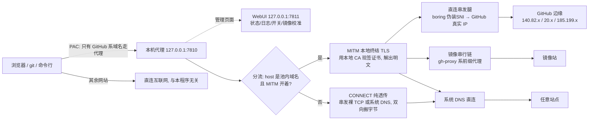
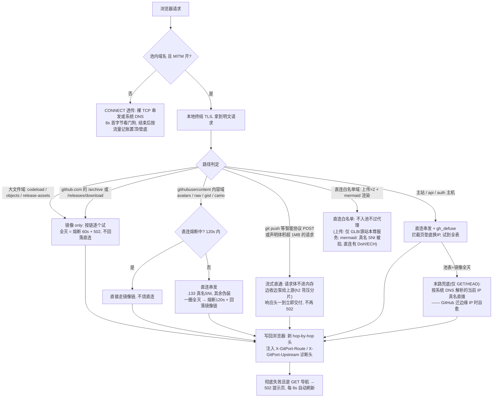
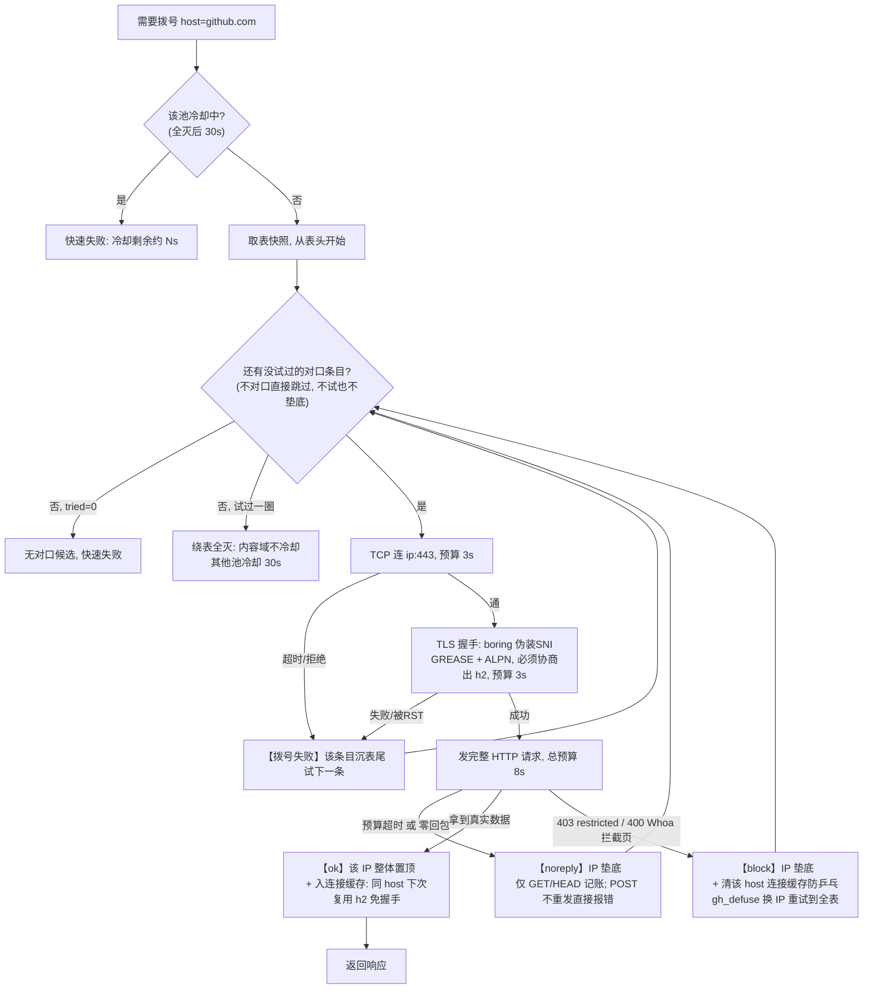
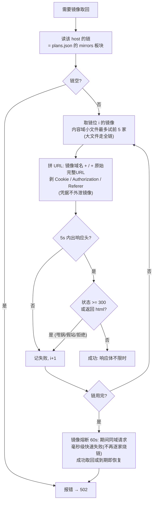

# GitPort GitHub —— GitHub 加速器 · 跨站加速代理

**中国大陆访问 GitHub 的本地加速器 —— 免插件、免服务器、后台仅 12MB。**
clone、push、网页上传、Release 下载、raw 文件、头像、网页浏览全场景加速，其余网站流量完全不受影响。
直连流量本机直达 GitHub 官方边缘，不经任何第三方；大文件镜像链虽经公共镜像，凭据（Cookie/Authorization + 签名查询串）一律剥离或拒绝转发，不外泄。

## 这是什么

本机跑一个代理（`127.0.0.1:7810`）+ 一个管理页面（`127.0.0.1:7811`）。它只接管 GitHub 系域名：

- **不查 DNS**：内置 GitHub 真实 IP 表（`plans.json`），DNS 污染直接绕过
- **连不上就换**：IP 按表逐个试，坏的垫底自动降级，单点故障只慢不掉
- **TLS 指纹是 Chrome 同款**：用 BoringSSL（Chrome 自己的 TLS 库）+ 伪装 SNI，绕过针对明文域名的阻断
- **大文件多一条路**：Release/源码包走镜像串行链，直连全灭时仍能下载

与常见方案对比：

| 方案 | 免插件 | 免服务器/账号 | clone/push | 后台占用 | 只碰 GitHub |
|---|---|---|---|---|---|
| **GitPort GitHub** | ✅ PAC 一键 | ✅ | ✅ | ~12MB | ✅ |
| 改 hosts | ✅ | ✅ | 部分 | — | ✅ 但 IP 失效即瘫 |
| gh-proxy 网页镜像 | — | 靠第三方 | ✗ | — | — |
| Watt Toolkit | ✅ | ✅ | 部分 | 较高 | ✅（多站点） |
| 通用代理/VPN | 视工具 | ✗（需节点） | ✅ | 视工具 | ✗ 全部流量 |

## 快速上手（3 步）

1. 双击 `gitport-github.exe`（或 `.\gitport-github.exe -tray` 驻留托盘）
2. 首次启动在 exe 同目录生成：`ca.crt`/`ca.key`（MITM 证书）、`plans.json`（IP 表）、`settings.json`（开关）
3. 浏览器直接用；或开「GitHub 分流接管」开关（写系统 PAC，免插件）

不开 MITM 也能用（纯透传加速）；开了 MITM 解锁内容域直连与流式直通，证书根由 WebUI 一键 certutil 安装。
系统代理接管在退出/关机时自动还原；崩溃强杀后的残留由下次启动自愈。

## 为什么选它

- **隐私边界清晰** —— 直连腿本机直达 GitHub 官方边缘，不经任何第三方；镜像链剥凭据；不开 MITM 时纯透传，代理看不到内容
- **后台常驻 12MB** —— 关窗到托盘后整个 WebView2 释放，托盘态占用 ≈ headless
- **全场景覆盖** —— 网页 / clone / push / Release / raw / 头像 / WebSocket
- **故障自愈** —— 换 IP / 换 SNI 形态 / 换镜像 / 系统 DNS 兜底腿，GitHub 迁边缘 IP 也能自愈
- **零服务器零账号** —— 双击即用，卸载就是删文件夹
- **不依赖 DNS** —— 内置 IP 表，污染免疫
- **只碰 GitHub 流量** —— 不改其他软件的代理设置，退出自动还原

## 已知边界

| 做不到 | 原因 | 应对 |
|---|---|---|
| 支持 macOS / Linux | 桌面框架是 Windows 专属 | macOS 用户推荐 Watt Toolkit / Clash Verge |
| 大文件上传快 | 伪装 SNI 链路上行带宽物理受限（实测 ~115KB/s 级） | 流式直通保证不 502 不堆积；中断后 git 整体重传 |
| 一劳永逸 | GitHub 边缘 IP 会迁移 | 种子补缺 + 系统 DNS 兜底腿自动自愈，极端情况手改 `plans.json` |
| 完全无门槛 | 开 MITM 需装本地根证书 | WebUI 一键 certutil 安装；不装也能用（纯透传） |
| 加速所有网站 | 只路由 GitHub 系域名 | Google / YouTube 等请用通用代理 |
| 私库 release 附件走镜像 | 镜像链剥凭据 + 拒绝带签名查询串的请求（防 Cookie/token 外泄，2026-10-17 审计加固） | 公库无感；私库附件 signed URL 镜像腿拒收，等直连恢复 |
| 内容域新建连接偶发被掐 | GFW 对 Fastly 内容边缘（.133/.154/.215，真名 SNI）的间歇性阻断：新建 TCP 黑洞、已建连接复用正常（表现为 raw 图/头像/图表"忽快忽死"） | DNS 兜底腿 + 镜像链自动接管；窗口过去后自动恢复直连（2026-10-17 实测记录） |
| MITM 下用 schannel 系 CLI 工具 | 本地叶子证书无 OCSP/CRL 吊销信息（certgen.rs `ocsp: None`），Windows 系统 TLS 栈吊销检查硬失败（CRYPT_E_NO_REVOCATION_CHECK）：`curl.exe` 直接拒绝握手，git 走默认 schannel 后端同样失败 | `curl --ssl-no-revoke`；`git config --global http.schannelCheckRevoke false`（或 git 换 openssl 后端）；浏览器吊销检查是软失败，网页使用无感。根治需本地 CRL/OCSP 端点，暂以客户端配置绕过 |

## 常见问题

<details>
<summary>git push 大包很慢怎么办？</summary>

伪装 SNI 链路的**上行**带宽有限（实测 ~115KB/s 级），与代理机制无关。流式直通已保证不 502 不堆积；
中断后重试即整体重传。详见「工作原理 → 大请求体与 git push」。
</details>

<details>
<summary>raw 文件偶发 6~8 秒才打开？</summary>

raw 的真名 SNI 被点名 RST，连败几个候补才拨通。内容域直连熔断（120s）+ 镜像兜底已就位，
之后自动走镜像，无需干预。
</details>

<details>
<summary>浏览器报证书风险？</summary>

MITM 开着但本地根证书未装/浏览器未重启。WebUI 开关自动 certutil 装根；装完重启浏览器一次。
不想要 MITM 就在 WebUI 关掉，退回纯透传。
</details>

<details>
<summary>和别的代理/工具端口冲突？</summary>

默认占 7810（代理）+ 7811（WebUI）。用 `.\gitport-github.exe -port 7812 -webui 7813` 换端口即可。
</details>

<details>
<summary>页面显示「暂时不可用」每 8 秒刷新？</summary>

真处于封锁窗口期（直连与镜像同时被波及），代理正在按表自动重试。窗口一过自动恢复，本页会自动刷新。
</details>

<details>
<summary>为什么 macOS 不支持？</summary>

桌面框架（tao/wry/托盘/tray-icon）按 Windows 实现（WebView2、certutil 装根、注册表 PAC）。
跨平台在 Roadmap，目前 macOS 用户推荐 Watt Toolkit。
</details>

## 工作原理

### 总架构



### 一次请求的完整旅程



### 直连白名单：有些域名不归代理管

三个域名被排除在代理之外，PAC 直接返回 `DIRECT`，浏览器用自己的解析直连，代理完全不参与：

- **objects-origin.githubusercontent.com**（网页上传 Release 的落点）：该 vhost **只由 GitHub 的 GLB 族**
  （140.82.11x.21/.22）服务，主站网页边缘对它一律 301 且不带 CORS 头——浏览器的跨域预检会直接失败，
  文件一个字节都发不出去
- **uploads.github.com**（API 式上传源站 alambic）：直连让 DNS 交给源站本尊，等价 gh CLI 的已知可用路径
- **viewscreen.githubusercontent.com**（mermaid 服务端渲染）：走代理要用**真名 SNI** 拨 Fastly 内容边缘，
  被间歇掐断且无镜像兜底（图表要等）；浏览器直连有 **DoH + ECH 加密 SNI**，实测一进仓库即出图

与其在表里猜"哪个 IP 服务它"，不如把这份知识还给 DNS。

**进白名单的硬前提（判据）**：任何域名想直连，先查两件事——① 系统 DNS 有没有被污染；② 真名 SNI 会不会被 GFW 重置。
经验规律：

- 解析到**主站 GLB / 源站家族**的域名（objects-origin、viewscreen → 140.82.11x.21/.22；uploads.github.com → alambic .161）
  → 无 DNS 污染、无 SNI 重置，**可直连**
- 落在 **Fastly 内容边缘 .133** 的域名（raw / camo / avatars）→ 真名 SNI 被 RST（实测 `TLS 握手失败:
  远程主机强迫关闭了一个现有的连接 (10054)`）→ **必须走代理**，直连必挂

2026-10-17 实测对照：

| 域名 | 系统 DNS | 真名 SNI | 结论 |
|---|---|---|---|
| objects-origin | 无污染（→ GLB 140.82.114.22） | 无阻断 | 直连 ✅ |
| viewscreen（mermaid） | 无污染（→ GLB 140.82.114.22） | 无阻断 | 直连 ✅ |
| uploads.github.com | 无污染（→ alambic .161） | 无阻断 | 直连 ✅ |
| raw | 无污染（→ 185.199.110.133） | **被 RST** | 走代理 |
| camo | 无污染（同一 IP） | 间歇黑洞 | 走代理 |

判定原则：**vhost → 边缘的映射只有 GitHub 的 DNS 知道；代理只接管"表能可靠覆盖"的域名**
（主站 / API / Fastly 三族），其余交给系统 DNS。这条原则也解释了为什么"越多的 IP 假设"反而越脆弱。

### 串发拨号与 IP 轮换（核心细节）

每个请求的拨号都走下面这个循环。**成功必须由数据层认证**——握手通不算成功，拿到真实数据才算；失败则分层记账：



**轮换规则速查表**（`serial_move` 的全部行为）：

| 触发事件 | 判定层 | 动作 | 写盘与日志 |
|---|---|---|---|
| 拨号成功且拿到数据 | 数据层 ok | 该 IP **整体置顶**（组内相对序不变） | 顺序真变更才置 dirty，2s 内原子写盘（tmp+rename）；表头变了打一行轮换日志 |
| TCP 连不上 / TLS 握手失败 | 拨号层 | 该**单条**沉表尾 | 同上 |
| 握手通但零回包 / 预算超时 | 数据层 noreply | IP 垫底（仅 GET/HEAD 记账，POST 失败不污表） | 同上 |
| 拦截页 403/400 | 数据层 block | IP 垫底 + 清该 host 的连接复用槽（防"垫底→复用→再垫底"乒乓） | 同上 |
| 同 IP 重复置顶（顺序没变） | — | **no-op**：不写盘、不打日志 | 否 |
| 请求预算到期（用户等不及） | ctx 取消 | 只掐正在试的那条，**不垫底、不冷却** | 否 |
| 绕表全灭，内容域 | — | 不冷却（镜像链兜底），直连熔断 120s | 打一行日志 |
| 绕表全灭，其他池 | — | 冷却 30s 快速失败 | 打一行日志 |

**对口规则**（`entry_serves`，防止不同类请求互相污染池序）：

| host 类型 | 只认哪类条目 | SNI 形态 |
|---|---|---|
| `*.githubusercontent.com` 内容域 | Fastly 末段 **.133** | 真名（伪装会被该边缘挂起） |
| `*.githubassets.com` 静态资源 | Fastly 末段 **.154 / .215** | 伪装（抗 SNI 阻断） |
| `github.io` / `*.github.io` | Fastly 末段 **.153** | 伪装 |
| 主站 / api / auth 主机 | 非 Fastly 段 | 伪装 `baidu.com` |

不对口的条目**跳过不试也不垫底**——否则每类请求都会把另一类的 IP 试败沉底，排序永远乒乓。

### 连接复用（快路径）

每 host 一个单槽缓存：**完整成功过一次**的链路（host→IP→h2 连接）才入槽。命中 = 零拨号零握手直接发请求；
失败 = 清槽重走串发。池序演化不主动切连接——缓存的连接活着就一直用，死了才换。

并发冷启动（一波页面几十个请求同时未命中缓存）走**拨号单飞**：只放一个进串发拨号，其余在 host 锁上排队；
首拨成功入槽后，排队者**立即放锁、锁外并发复用**（拨号锁只罩拨号等待，不罩请求发送——持锁到发送
会把单页 129 个并发资源压成逐个 RTT 串行，实测曾致首屏绘制 34 秒）。

**活跃窗口内保活（2026-10-17）**：上游 h2 连接会被边缘按空闲回收（实测 50-65 秒），跨页面导航时
就变成"重新握手 1.3 秒"——表现为进入新页面的轻微换页感。对策：有请求后每 30 秒对**所有已缓存的
连接**（主站 / API / 头像图片样式族）发一个 h2 PING 帧（不发 HTTP 请求、不触风控、对端 ACK 即验活），
只续命真实请求建立过的连接、绝不预建新通道；静默 5 分钟后自动停——连续浏览时页面导航走缓存连接
（~300ms 首包，头像/图片同理），**空闲时没有任何定时器，进程照常纯睡**。

### 压缩传输

上游请求的 `accept-encoding`：`github.com` / `api.github.com` **强制 `gzip`**（2026-10-17 起），
其余域名一律放行浏览器原生 br/zstd——GitHub 页面的 HTML/CSS/JS 全程压缩传输
（实测仓库页 327KB → 44.5KB、单页资源合计 3.7MB → 约 550KB）。
gh_defuse 的拦截页嗅探不受影响：代理侧**边收边解压判前 4KB 明文**，已消费的**原始压缩帧原样转发**
给浏览器（不重压缩、不改 content-length，解压由浏览器负责）。配合上游 h2 流控窗口
（流 1MB / 连接 4MB）与并发复用，这是"进仓库快"的完整链路——大仓库的大文档同样走 5-7 倍压缩。

### 镜像链（串行逐家；内容域限长前 5 家）

镜像链覆盖 9 个 host：8 个内容域（raw / gist / avatars / user-images / codeload / objects / release-assets / media）
加 github.com（专供 `/archive` 与 `/releases/download` 路径）。
CSS/JS 与 github.io 不过镜像（实测全 404），归 edge 直连池。

**与直连串发同一哲学：一家失败再试下一家，绝不并发。** 内容域小文件（头像/图片/gist/media）
只试链上**前 5 家**（每家 5s 预算）——把一张坏图标的最坏等待从"11 家逐家超时"收窄；
大文件走全链（逐家拉，不并发，避免多份大流量）。



**链序从哪来**：内置默认序（8 host × 11 镜像实测 TTFB 排好）→ UI「校准」按钮半自动重排 → 手改 `plans.json`。
校准 = 对每条链串行实测 TTFB（host 之间并行，链内严格串行，全程约 30~90 秒），按成绩升序重排，
失败条目按原相对序排尾，写回并返回人读报告。新镜像上线自动补到各链尾部。

多图仓库（README 塞 20+ 张图的）撞上直连+镜像双全灭窗口时，每张图原本都要串行烧完 11 家镜像才认输，
页面转圈几分钟；镜像熔断后第 2 张起毫秒级快速失败，窗口一过自动恢复。

### 大请求体与 git push（流式直通）

对请求体一刀切缓冲且有上限会让 git push 的大 pack 必挂，因此按下面规则转**流式直通**：
请求体不进内存，边收边泵给上游（h2 按对端授予的发送窗口分片，单次发送严禁超窗口），
GB 级也不堆积（实测 28MB 泵送期间代理常驻内存仅 +3MB）。

| 请求形态 | 走法 |
|---|---|
| `POST …/git-receive-pack`（push）/ `POST …/git-upload-pack`（fetch 协商） | 必流式（无论大小） |
| 声明 `content-length` > 1MB 的其他请求（PUT 上传等） | 必流式 |
| 声明未超限、实际读着读着超了 | 缓冲转流式：已读的 ≤1MB 前缀作为首块续泵，不丢请求 |
| GET / HEAD / 常规小体 | 原有缓冲路径（可重放重试），行为不变 |

关键语义：

- **响应头一到立即交付客户端**——上游可能收到一半就拒绝（如 413），客户端必须拿到 GitHub 的真实响应而不是代理的 502
- **截断保护**：客户端上传中途断开，泵弃流不补 EOS——git pack 尾部带校验和，截断包必须被服务端拒绝，绝不能被当完整包处理
- **单次尝试**：与既有"非简单方法不重发"一致；连接失效且体未动时允许换新拨重试一次，泵启动后不重试（git 客户端自身会重试）
- 流式响应头预算 1800 秒（git push 大包时服务端收完包并解包校验才应答）

## 术语速查

### 网络与封锁

| 名词 | 大白话 |
|---|---|
| 域名 / IP 地址 | 域名是"名字"，IP 是"门牌号"。`github.com` 是名字，`140.82.112.3` 是门牌 |
| DNS | 查号台：把名字翻译成门牌。查号台可被投毒（给你假门牌）——本程序根本不问它，**内置了一张 GitHub 真门牌表**（`plans.json`） |
| TCP 连接 | 电话拨通。拨不通 = 这个 IP 当下不可用 |
| TLS 握手 / HTTPS | 电话接通后先对暗号、换加密频道，之后通话内容外人听不懂 |
| SNI | 握手第一句里**明文**写的"我要找 xx 域名"。审查就盯着这一句看 |
| ALPN / h2 | 对暗号时顺便约定讲哪种方言（HTTP/2 还是老的 1.1）。GitHub 边缘要求必须协商出 h2 |
| RST | 掐断电话：连接被中途强制挂断 |
| 黑洞 | 石沉大海：包发出去永远没有回音 |
| CONNECT 隧道 | 浏览器对 HTTPS 站点用的方式：代理只负责"接通电话然后搬运加密箱"，箱里是什么看不见 |
| MITM（中间人） | 代理持有本地钥匙，把箱子拆开看明文、必要时换条路重发，再重新装箱给浏览器。需要浏览器信任代理自办的"工作证"（CA 证书） |
| CA 证书 | 自办工作证。`ca.crt` 装进系统"受信任的根"后，浏览器才认代理现签的证书 |
| 指纹（JA3） | TLS 握手第一句的"笔迹"——套件顺序、扩展排列。笔迹像个脚本库会被认出来；本程序用 **boring**（BoringSSL = Chrome 自己在用的 TLS 库），笔迹天然是 Chrome 同款，不是仿的 |

| 封锁 | 原理 | 本程序的绕法 |
|---|---|---|
| DNS 污染 | 查号台给假门牌 | 不查号，内置真 IP 表 |
| SNI 阻断 | 盯握手第一句的明文域名，看到 github 就掐 | **伪装 SNI**：第一句写 `baidu.com`，证书却按真域名验证（SNI 与校验名解耦）。例外：`185.199.x.133` 这个边缘伪装会被挂起，只能真名 |
| IP 黑洞 | 门牌本身被断路 | **串发换 IP**：按表逐个试，坏的垫底换下一个 |
| 风控 | 服务器认得你，故意回拦截页（403 restricted / 400 Whoa） | **gh_defuse**：本地认出拦截页，该 IP 垫底，换 IP 重试到全表 |

### 本项目机制词

| 名词 | 大白话 |
|---|---|
| IP 池 | 某类域名的候选 IP 排队名单，存 `plans.json`。三个池：`core`（主站）/ `api` / `edge`（授权+静态+内容域） |
| 表头 | 名单第一名 = 现在正在用的 |
| 串发 | 排队逐个试，一把锁不开换下一把（对比：~~竞速~~ = 全部一起试，会打爆公共镜像，已弃用） |
| 置顶 / 垫底 | 排队次序调整：通的升表头，坏的沉表尾 |
| 冷却 | 绕表全灭后 30 秒内快速失败，不反复烧表 |
| 熔断 | 跳闸：内容域直连失败一次，120 秒内直接走镜像，不再逐个烧 IP；镜像链全灭同理——60 秒内该域快速失败，不再逐家烧链 |
| 流式直通 | 大请求体（git push 的 pack、超 1MB 的上传）不进内存缓冲，边收边泵给上游——GB 级也不堆积，响应头一到立即回传 |
| 镜像链 | 每种资源的"复印店优先级名单"（gh-proxy 系 11 家），串行逐家用 |
| 预算 | 一次尝试最多等几秒（拨号 3s、响应 8s、镜像响应头 8s、流式响应头 1800s——git push 大包服务端收完包才应答） |
| 首字节看门狗 | 电话通了但对方 8 秒不吭声 → 判死 |
| gh_defuse | 拦截页化解机制的名字 |

## 高级配置

### 命令行参数

```powershell
.\gitport-github.exe            # 默认：桌面壳 + 托盘
.\gitport-github.exe -headless  # 无窗口：只跑代理 + 管理页面
.\gitport-github.exe -tray      # 开机自启用：直接驻留托盘
.\gitport-github.exe -port 7812 -webui 7813   # 与其他实例共存时换端口
```

### plans.json 手改指南

```json
{
  "core": [
    { "ip": "140.82.112.3", "sni": "baidu.com" },
    { "ip": "20.205.243.166" }
  ],
  "api":  [ { "ip": "140.82.112.5", "sni": "baidu.com" } ],
  "edge": [ { "ip": "185.199.108.133", "sni": "sni" } ],
  "mirrors": {
    "raw.githubusercontent.com": ["https://gh-proxy.com", "https://ghfast.top"]
  }
}
```

- 条目顺序 = 优先级，第一行是表头；`sni` 省略或写裸域名 = 伪装；`"sni": "sni"` = 真名（仅 .133 需要）
- 手改**重启生效**；运行中的轮换 2 秒内自动写回（手改请先关代理，避免被写回覆盖）
- 表会自愈：缺池/缺新边缘 IP 时启动自动从内置种子补齐（只追加尾部，不打乱你排的顺序）；池外镜像/未知 host 写了也会被剥掉
- 镜像链里只能写内置 11 家，顺序随意

### 认 IP 速查（哪个 IP 干什么活）

条目放哪个段**不影响行为**——代码按 IP 末段路由（`entry_serves`），段只是容器。认 IP 看末段和前缀：

| 看到这种 IP | 它是谁 | 干什么活 | SNI 形态 |
|---|---|---|---|
| `140.82.x.3` / `.4` | 主站边缘 | github.com 网页 | 伪装 |
| `140.82.x.5` / `.6` | API 专用边缘 | api.github.com（与网站 IP 互斥） | 伪装 |
| `140.82.x.29` / `.30` | 授权边缘 | githubapp.com 登录/OAuth 回调 | 伪装 |
| `20.205.243.161` | 上传源站（alambic，单租户） | uploads.github.com（API 式上传；**网页上传 Release 走 objects-origin 直连白名单，不经此 IP**） | —（直连白名单，代理不拨它） |
| `20.x.x.x`（Azure 段）、`4.237.x`、`172.182.x` 等杂段 | 主站边缘备选 | github.com 网页 | 伪装 |
| `185.199.x.133` | Fastly 内容边缘 | avatars / raw / gist / camo 等 githubusercontent 族 | **真名**（伪装会被该边缘挂起） |
| `185.199.x.215` | Fastly 静态边缘（**新**，2026-10 起 assets 已迁至此） | githubassets 的 CSS/JS | 伪装 |
| `185.199.x.154` | Fastly 静态边缘（旧代边缘，2026-10 中曾失联后又复活——状态波动，以实测为准） | 同上 | 伪装 |
| `185.199.x.153` | Fastly Pages 边缘 | github.io 站点 | 伪装 |

即：**末段 .3/.4 = 网页，.5/.6 = API，.29/.30 = 授权，20.205.243.161 = 上传源站；185.199 段看末段——.133 = 头像内容，.215 = 静态（新），.154 = 静态（旧），.153 = Pages**。
`185.199.x.133` 条目的 `sni` 恒为 `"sni"`（真名），一眼即可认出；`185.199` 段带伪装的就是静态/Pages 边缘。
此分工由边缘行为实测标定， plans.json 里的段位置、你手写的 sni（对 185.199 段）都改变不了它。

### 分流域名总表

| 流量 | 上游路径 |
|---|---|
| github.com 及其余子域 | core 池直连串发（伪装 SNI）+ gh_defuse |
| api.github.com | api 池直连串发（API 专用边缘，与网站 IP 互斥） |
| uploads.github.com | **直连白名单**（API 式上传源站；不入池、不过代理，DNS 直达 alambic .161——等价 gh CLI 可用路径；原专用池与验收名覆盖已随之删除。网页上传 Release 实际走 objects-origin） |
| viewscreen.githubusercontent.com | **直连白名单**（mermaid 服务端渲染；代理腿真名 SNI 被间歇掐且无镜像兜底，直连走浏览器 DoH/ECH 加密 SNI——2026-10-17 实测直连即出图） |
| githubapp.com（授权）、githubassets、github.io | edge 池直连串发 |
| avatars/camo/gist/raw 等内容域 | edge 直连优先 → 熔断后镜像链 |
| codeload / objects / release-assets | 镜像 only |
| github.com 的 `/archive`、`/releases/download` | github.com 镜像链，串行取用，全灭 502 |
| objects-origin.* | **直连白名单**（不入池、不过代理，系统 DNS 直达 GLB 族——该 vhost 仅 GLB 服务，主站边缘对其 301 无 CORS → 浏览器跨域预检失败、上传必败。2026-10-17 逐 IP 实测） |
| 其余一切域名 | 系统 DNS 直连，不经任何表 |

## WebUI 功能（127.0.0.1:7811）

- 概览：运行状态、代理地址、连通徽标、最近日志
- IP 池：三池条目一览（顺序即优先级，表头即正在用）；objects-origin 与 uploads.github.com 是直连白名单（不入池、不上 UI，日志不会出现它们的隧道记录，属正常）
- 设置：开机自启、关窗到托盘（✕ = 释放整个 WebView2，托盘态只剩代理核心约 12MB ≈ headless；点托盘图标随时重开工作台）、GitHub 分流接管（PAC）、MITM 开关（自动 certutil 装根，装完重启浏览器一次）
- 镜像链校准：约 30~90 秒，期间可正常上网

## 构建与验证

```powershell
cargo build --release   # 产物 target\release\gitport-github.exe（连同 assets\icon.ico 即为 dist）
cargo test              # TLS 握手探针、迁移归一、轮换 no-op 等行为契约
```

## Roadmap

- 多站点加速（HuggingFace 等）：拨号引擎、串发表、镜像链均为数据驱动，扩服务 = 加数据不改代码；自建 worker 反代通道已预留设计

## 声明

- 本工具仅供学习网络原理与个人自用提速，请遵守所在地区法律法规，使用产生的一切后果由使用者自行承担
- 本项目与 GitHub 无任何隶属或合作关系
- 镜像链依赖的第三方公共镜像与本项目无关，可用性随它们变化
