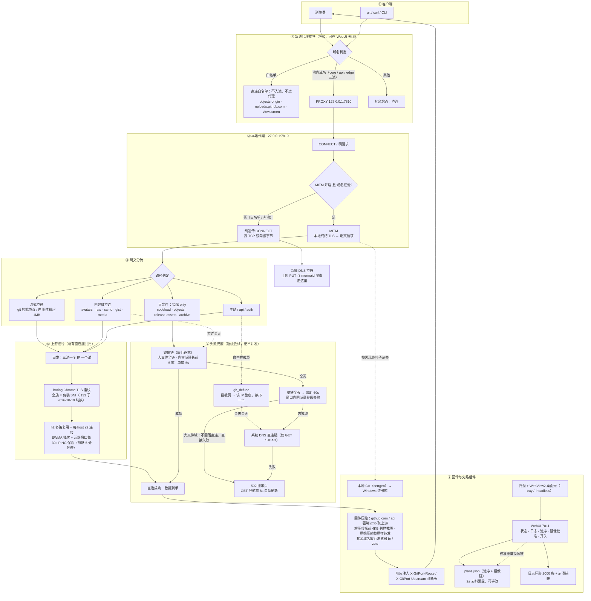
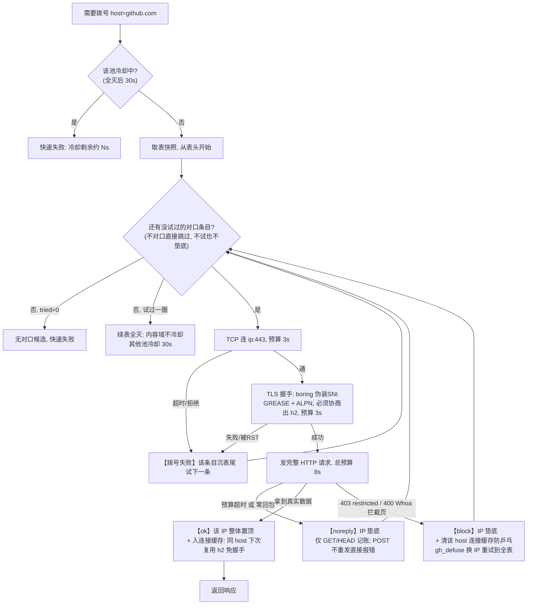

# 工作原理

从浏览器点开仓库到字节回到屏幕的完整链路：PAC 分流 → 代理入口 → 明文分流 → 上游拨号 → 失败兜底 → 回传压缩。

## 直连白名单

三个域名 PAC 直接返回 `DIRECT`，代理完全不参与：

- **objects-origin.githubusercontent.com**（网页上传 Release 落点）：该 vhost 只由 GLB 族（140.82.11x.21/.22）服务，主站边缘对它一律 301 且无 CORS 头——浏览器跨域预检直接失败，上传必败
- **uploads.github.com**（API 式上传源站）：DNS 交给源站本尊，等价 gh CLI 已知可用路径
- **viewscreen.githubusercontent.com**（mermaid 渲染）：代理腿真名 SNI 被间歇掐断且无镜像兜底；浏览器直连时通时断，实测一进仓库即出图（GitHub 不发布 HTTPS RR，非 ECH）

**进白名单的硬前提**：① 系统 DNS 未被污染；② 真名 SNI 不被 GFW 重置。经验规律：解析到主站 GLB / 源站家族 → 可直连；落在 Fastly 内容边缘 .133 → 真名 SNI 被 RST（`10054`）→ 必须走代理。

| 域名 | 系统 DNS | 真名 SNI | 结论 |
|---|---|---|---|
| objects-origin | 无污染（→ GLB 140.82.114.22） | 无阻断 | 直连 ✅ |
| viewscreen | 无污染（→ GLB 140.82.114.22） | 无阻断 | 直连 ✅ |
| uploads.github.com | 无污染（→ alambic .161） | 无阻断 | 直连 ✅ |
| raw | 无污染（→ 185.199.110.133） | **被 RST** | 走代理 |
| camo | 无污染（同一 IP） | 间歇黑洞 | 走代理 |

判定原则：vhost → 边缘的映射只有 GitHub 的 DNS 知道，代理只接管"表能可靠覆盖"的域名（主站 / API / Fastly 三族），其余交给系统 DNS。

## 串发拨号与 IP 轮换

每个请求的拨号循环。**成功必须由数据层认证**——握手通不算，拿到真实数据才算：

**轮换规则速查**（`serial_move` 全部行为）：

| 触发事件 | 判定层 | 动作 |
|---|---|---|
| 拨号成功且拿到数据 | 数据层 ok | 该 IP 整体置顶（组内相对序不变）；2s 内原子写盘 |
| TCP 连不上 / TLS 握手失败 | 拨号层 | 该单条沉表尾 |
| 握手通但零回包 / 预算超时 | 数据层 noreply | IP 垫底（仅 GET/HEAD 记账，POST 失败不污表） |
| 拦截页 403/400 | 数据层 block | IP 垫底 + 清该 host 连接复用槽（防乒乓） |
| 同 IP 重复置顶 | — | no-op：不写盘不打日志 |
| 请求预算到期 | ctx 取消 | 只掐正在试的那条，不垫底不冷却 |
| 绕表全灭，内容域 | — | 不冷却（镜像兜底），直连熔断 120s |
| 绕表全灭，其他池 | — | 冷却 30s 快速失败 |

**对口规则**（防不同类请求互相污染池序；不对口跳过不试也不垫底）：

| host 类型 | 只认哪类条目 | SNI 形态 |
|---|---|---|
| `*.githubusercontent.com` 内容域 | Fastly 末段 .133 | 伪装（2026-10-19 切换；Fastly 默认证书 SAN 覆盖全系） |
| `*.githubassets.com` 静态资源 | Fastly 末段 .154 / .215 | 伪装 |
| `github.io` / `*.github.io` | Fastly 末段 .153 | 伪装 |
| 主站 / api / auth 主机 | 非 Fastly 段 | 伪装 `baidu.com` |

## 连接复用

每 host 最多 **2 条** h2 连接（高频 host 才补第二条：github.com / api / raw / avatars / githubassets）。完整成功过一次的链路才入槽，命中 = 零拨号零握手；失效按连接 id 精确摘除重走串发。第二条连接自动落到**不同 IP**（避开边缘对同 IP 复用的降权）。

**为什么是两条**：GitHub 边缘按连接限并发——单连接 24 并发实测全部同一时刻返回（p50 = p95 = 1036ms），两条压到 **332ms**，四条不再改善。跨 host 不合并：core/api 走不同边缘 IP，且合并会破坏"按 host 冷却/熔断"的隔离。

**取用策略**：默认轮转，但按每条连接的 **EWMA 实测耗时**择优（α=0.3，每 8 次留 1 次探索防假死）——实测两条连接质量差 3.6 倍时，纯轮转会把一半请求喂给慢连接（p50 1671ms vs 460ms）；择优后 github.com p90 3591→530ms、max 5860→920ms。

并发冷启动走**拨号单飞**：只放一个进串发拨号，其余在 host 锁上排队；首拨入槽后排队者立即放锁、锁外并发复用（拨号锁只罩拨号等待不罩发送——持锁到发送会把单页 129 个并发压成逐个 RTT 串行，实测曾致首屏 34 秒；锁内无条件重查缓存——省一次重查曾致 GOAWAY 后 18 个请求排队拨号 10 秒+）。

**活跃窗口保活**：上游 h2 连接被边缘按空闲回收（实测 50-65 秒），跨导航会变成重新握手 1.3 秒。对策：有请求后每 30 秒对所有已缓存连接发 h2 PING 验活（不发 HTTP 请求、不触风控），只续命真实请求建过的连接；静默 5 分钟自动停，空闲时零定时器。

## 遥测拦截

GitHub 前端往 `api.github.com/_private/browser/*`（Datadog RUM）报性能与错误数据，另有 `alive.github.com` 心跳、`collector.github.com` 埋点——实测一次会话里这些占 api.github.com 上游请求的 **75%**（325/436），把搜索历史等真 API 挤在后面。

对策：这三类请求本地读掉请求体直接回 **204**，一个字节不发往 GitHub。拦截后 api.github.com 上游请求归零（只剩隧道解密记录），搜索 count 一批 300~450ms 完成。

## 压缩传输

`github.com` / `api.github.com` 强制上游 gzip（实测仓库页 327KB → 44.5KB），其余域名放行浏览器原生 br/zstd。拦截页嗅探边收边解压判前 4KB，已消费的原始压缩帧原样转发（不重压缩、不改 content-length）。

## 镜像链

覆盖 9 个 host：8 个内容域 + github.com（专供 /archive 与 /releases/download 路径）。CSS/JS 与 github.io 不过镜像（实测全 404）。

- **串行逐家，绝不并发**；内容域小文件限前 5 家（每家 5s），大文件全链
 - 链序：种子快照序（随表演化，代码零内置）→ UI「校准」重排 → 手改 plans.json
- 校准两模式：大文件四链 5MB 下载竞速（12s 窗口按实收字节排名）；图片五链响应头测速。host 间严格串行防测量污染；均为后台任务，关窗进托盘继续跑完
- 镜像请求走共享连接池（每镜像 4 条空闲、60s 回收），批量加载/Range 续传不再逐次握手
- 整链全灭熔断 60s，窗口内同域毫秒级快速失败

## 大请求体与 git push（流式直通）

| 请求形态 | 走法 |
|---|---|
| `POST …/git-receive-pack` / `…/git-upload-pack` | 必流式（无论大小） |
| 声明 content-length > 1MB | 必流式 |
| 声明未超限、实际超了 | 缓冲转流式：已读前缀作首块续泵 |
| GET / HEAD / 小体 | 缓冲路径（可重放重试） |

关键语义：响应头一到立即交付客户端（上游拒了也要让客户端拿到真实响应）；客户端断开时泵弃流不补 EOS（git pack 尾带校验和，截断包必须被服务端拒）；单次尝试不重发；流式响应头预算 1800 秒。
