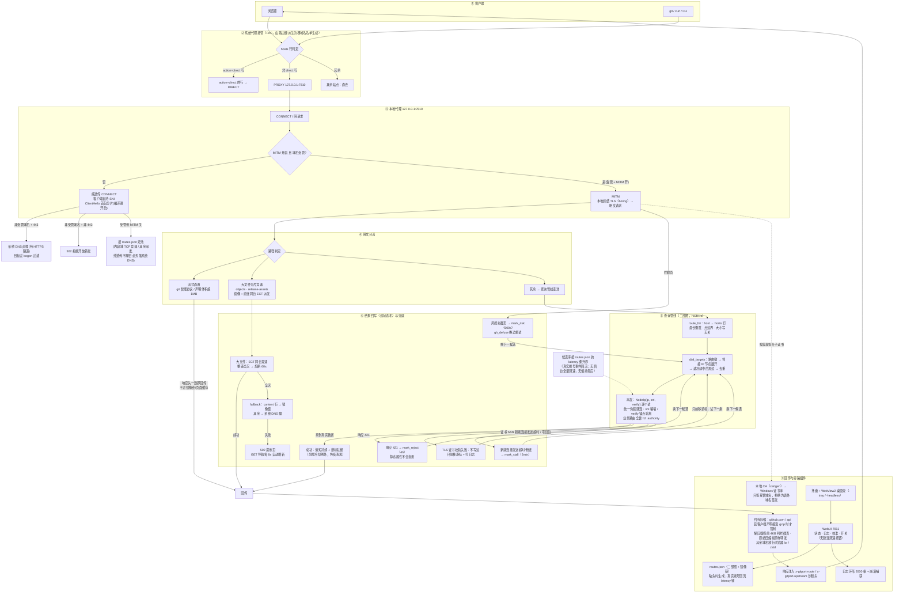
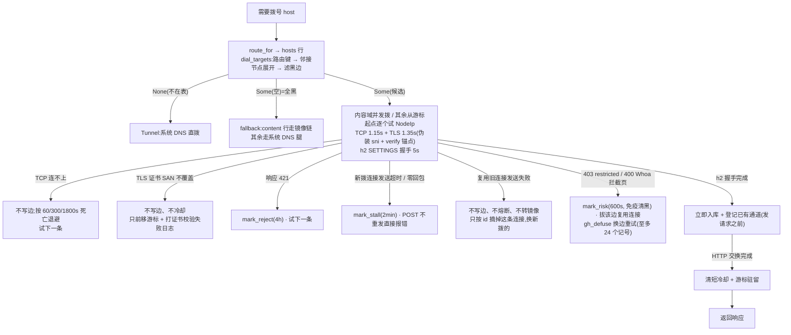

# 工作原理

从浏览器点开仓库到字节回到屏幕的完整链路:PAC 分流 → 代理入口 → 明文分流 → 查询管线(路由 v2 二部图) → 伪装统一建连 → 失败兜底 → 回传压缩。

> [ROUTING.md](ROUTING.md) 文末附录是 **v1 时代的历史实测存档**，判定逻辑已被 v2 取代，不要当现行依据；[CONFIG.md](CONFIG.md)「认 IP 速查」是 IP 段的实测标定，仍可参考 (原 POOL-V2.md 已随 v1 清理删除)。本文写运行时行为，以 `src/` 代码为准。



## 路由表 v2:二部图与边状态机

v1 的池/族/对口规则已全部退役,替换为一张数据表(`routes.json`)+ 一台边状态机。手改指南见 [CONFIG.md](CONFIG.md)。

- **hosts 行(策略侧)**:域名键 → `action:"direct"`(本机直连)/ `content`(内容域短预算,直连全灭后按 fallback 转镜像)/ `fallback`(dns 或 mirror)。**进不进 PAC 不需要单独字段**:非 direct 行自动进,运行时按路由键派生裸域名。最长键胜,`*.` 只认子域,点边界防误吞。
- **ips 节点(身份侧)**:IP(末段支持 `a-b` 范围展开,笛卡尔积上限 64)→ `sni`(骗墙的伪装域)+ `verify`(证书校验锚点,空 = 按目标 host 校验)+ `hosts`(声明服务哪些路由键)。**伪装身份与目标 host 解耦**——业务路由全靠 h2 `:authority`,所以一条连接可以混发多个 host 的流。
- **边状态机(运行时实测)**:表是预判,边是实测。`(IP, 路由键)` 三档坏态:响应 **421** → 拉黑 4 小时(静态属性);**新拨连接**发送超时/断连 → 降权 2 分钟(网络波动);风控拦截页 → 600 秒(对齐 GitHub 限流窗)。**写边只发生在响应处理层,拨号层一次都不写**:TLS 证书校验失败(SAN 不覆盖)不记边、不冷却,只前移游标并打一行 `证书校验失败` 日志;TCP 连不上也不写边,走 60/300/1800 秒的死亡退避。**成功只清短冷却(超时/421),风控冷却免疫清黑、只随时间过期**——风控页本身就是一次"成功"的 HTTP 交换,可清就会在风暴里被并发回写当场洗掉(实测:26 家候选 3 轮就回头的事件根因)。
- 触发条件刻意收窄:**业务状态码 403/404/429 一律不碰边**——那是 GitHub 在回答请求内容,不是"这个 IP 不服务这个 host"。

历史版本(v0.5.4 前)的直连白名单 4 域与真名分片白名单 10 域,已按 2026-11-03 的 openssl 实测全部入池:前者配 GLB / alambic 专节点 + 锚点,后者的 Fastly 组改走伪装锚点。`real` / `donor` / 借道记账整套退役。

## 串发拨号与边轮换

每个请求的拨号循环。**握手通不算完成,HTTP 交换完成(收到响应)才算**——这层看不见响应是不是风控页,所以风控冷却做成免疫清黑、只随时间过期;边状态(黑边滤网)在进循环前已经把冷却中的 (IP, 路由键) 剔除:



**轮换规则速查**:

| 触发事件 | 判定层 | 动作 |
|---|---|---|
| HTTP 交换成功拿到真实数据 | 响应层 | h2 握手完成即已入库;此处清短冷却 + 游标驻留(只记串发域主键;风控冷却例外) |
| 响应 421 | 响应层 | mark_reject,4 小时长冷却 |
| TLS 证书 SAN 不覆盖 | 拨号层 | **不写边、不冷却**,只前移游标 + 打日志;那是本地校验没过,不是对端拒绝 |
| TCP 连不上 / 被拒 / RST | 拨号层 | **不写边**,按 60/300/1800 秒死亡退避 |
| 新拨连接发送超时 / 断连 | 响应层 | mark_stall,2 分钟短冷却;POST 不重发不污账 |
| 复用旧连接发送失败 | 响应层 | **不算直连失败**:只摘该连接、本次后续只走新拨连接;不记边、不熔断、不转镜像 |
| 403 restricted / 400 Whoa 拦截页 | 风控 | mark_risk,600s 免疫成功清黑 + 拔该边复用连接(防乒乓);gh_defuse 换边重试至多 24 个记号 |
| 全部候选黑 | — | fallback:content 行走镜像链,其余走 DNS 腿;冷却 30s |
| 建造硬窗 15s 耗尽 | 预算层 | 本次请求交兜底,后台串发继续(落池供下一条骑);无镜像兜底才按 host 冷却 30s,不记黑不写边 |
| 同 IP 重复驻留 | — | no-op:不写盘不打日志 |

与 v1 的对应关系:旧的"对口规则 / 池 / 族"由节点的 `hosts` 声明 + 边实测取代——**不对口不试不垫底**的语义还在,只是"对口"从代码里的族表变成了数据里的边。历史实测(白名单腿、真名分片)见 [ROUTING.md](ROUTING.md) 附录。

## 连接复用

连接池的 key 是 **IP 节点**(伪装身份统一),**一条连接混发多个 host 的流**(h2 `:authority` 路由,业务身份与 TLS 身份解耦)。服务端视角"新建第一条"与"复用第一百条"不可区分——同 IP 同伪装身份同 `:authority`。**同 IP 恒 1 条**(会话域/内容域/其他一视同仁):`store_h2` 入库发现该 IP 已有正编,新拨的当场关闭、把池里现成那条交回调用方;要更多通道就换 IP 另起。同 IP 第二条实测只摊薄连接级窗口(185.199 段聚合水管约 36KB/s),不加吞吐,所以同 IP 溢出已废。

**取用统一入口**:`pool::get_or_build(host, probe_path, log)` 一站式——① 选(会话域只认自己建的通道,内容域/其他谁闲用谁)→ ② 池空进建造(per-host 建造锁等待队列防雷群,等锁带 15s 总窗、唤醒后双检;候选全被别的 host 占用才松锁 50ms 重查;建造受同一硬窗约束,超时交兜底、串发后台继续)→ ③ 全部通道顶满才溢出。溢出只挑**零通道且不在冷却**的候选 IP 补建一条临时通道,pick 与通道清单都不外发它;补不出就骑现有连接给 h2 排队。会话域不溢出。请求路径不再各管一段查池/拨号/重试。

**取用策略(门房打分)**:只有占用率——每条连接记在途流数和服务端 `SETTINGS_MAX_CONCURRENT_STREAMS` 下发的上限,分数 = (在途 + 1) ÷ 上限;没顶满的优先、分小者胜,全满时按分数最小者给 h2 自己排队。EWMA 延迟打分已随探活一起移除,代码里没有"挑最快那条"这回事。

**拨号分工**(与上面的取用是两件事,别混):`dial_upstream` 按 host 类别分流——内容域走 `race_build`:候选 IP 并发拨,按拨号耗时取最速一条入池,落败腿当场关闭、迟到腿后台收尸;会话域/低频域走 `dial_h2_race` 单腿串发,全局认领保证同一 IP 同时只有一条腿在拨,会话域跳过已有通道的 IP。旧的 `plan_legs` 主副腿分工已不存在。大文件域(objects / release-assets)和 12 个不值得养专属通道的子域(只去 Fastly 边缘的 docs / support / resources / desktop / pages / skills / archiveprogram / socialimpact / raw.github.com / agent,加超低频的 uploads / api.mcp)也是单腿串发,优先用池里现有的、没有才自建。

**同 IP 并发拨不设仲裁**:两个 host 的第一发同时落在同一个空 IP 上,就让它俩都拨——入库时 `store_h2` 按"一 IP 一通道"兜底,输家的握手(300-700ms,连上即关)是接受的代价,输家请求本身不受影响(拿到手里的是池里现成那条)。历史上有过按 **主站 > api > 一般内容 > avatars** 挑赢家的独立仲裁器,实测它的保护面只剩"每批省两三条白打的握手",撑不起一个全局协调器,已退役(git 历史可寻回);当年 27 条拨号风暴的真正防火墙是 per-host 建造锁,不是它。同 IP 的全局认领只防重复拨号,不争赢家。

**"已有通道"只有一个口径**:连接池本身。"这个 IP 有没有通道"的查询全部走池(`occupied_ips`),没有第二本账,也就不存在「池里摘了、表里还挂着」的两账本漂移竞态。最后一条连接被摘除,该 IP 自然允许重拨——连接自己断掉也算摘除:驱动任务结束即按 id 自行从池中除名,不必等下一次请求撞见死连接。

**通道失败上报**:通道上的请求失败(`pool::report_failure`)按来源分账——**本轮新拨的**通道首发即败,这个 IP 这会儿确实不行:摘通道 + 边级短冷却(2min) + 游标前移;**池里骑来的**旧通道失败只说明这条连接死了,IP 一点没试过:只摘不罚(实测复用超时后 1 秒同 IP 新建 334ms 就回 200,冤枉好 IP 会把直连逼进镜像链)。摘掉后 `get_or_build` 再取一条重试一次,再败才交镜像/DNS 兜底。

**即用即建、用完就丢(探活已整体移除)**:连好之后不养着——每条连接自带的驱动任务每秒扫一次:溢出通道在途归零即刻焚;普通通道闲置(**在途流为零**)满 **10s** 即焚,长下载因为一直有在途流不会被误杀。下次请求自己重拨,不靠探活验尸,也不留没人管的尸体。会话域同样 10s 回收,断开记一行日志,游标钉着原 IP,下一个会话请求重拨落回原家。机器睡眠唤醒不需要专门机制:醒来后旧连接按闲置计时自清。

**黑洞处置**:真实请求响应头到了但 **30s** 内第一个数据字节没来(`BLACKHOLE_FIRST_BYTE_MS`)判黑洞,由响应层上报 `on_channel_blackhole`:会话域摘通道 + 游标挪下一候选 + 拨号排序降权并立即预建(顺序故障转移、单活,不算跨 IP 并发);内容域软禁黑 IP 60s(不进 pick、在途流不杀)+ 全量换血补缺;其他低频域暂缓即可。不用等下次请求骑上去撞超时才发现。

**TLS 会话恢复**:重拨不再从零握手——按 SNI 形态缓存最近一张 session ticket(伪装腿一张管全族),重拨注入后走 1-RTT PSK:不重传、不验整条证书链,服务器拒绝时自动回落完整握手,无副作用。仅存内存,进程重启自然失效;不启用 0-RTT(重放面大)。

**起点记忆**(settings.json `lastIp`):只记串发域(会话域+其他低频域)一把主键;内容域竞速选路、游标无人读、不占键位。语义是**冷启动第一跳建议**——热路径不消费它(按占用率择优直接取用),且是排序建议不是直通卡:必须先过黑边滤网才准排最前,旧功臣不能绕过新实测的坏边。复用成功也回写,起点跟着"最近功臣"漂移。

## 遥测拦截

GitHub 前端往 `api.github.com/_private/browser/*`（Datadog RUM）报性能与错误数据，另有 `alive.github.com` 心跳、`collector.github.com` 埋点——实测一次会话里这些占 api.github.com 上游请求的 **75%**（325/436），把搜索历史等真 API 挤在后面。

对策：这三类请求本地读掉请求体直接回 **204**，一个字节不发往 GitHub。拦截后 api.github.com 上游请求归零（只剩隧道解密记录），搜索 count 一批 300~450ms 完成。

## 压缩传输

`github.com` / `api.github.com` 按客户端声明**重写协商头**：接受 br 的客户端发 **"br, gzip" 双档**（v6.10 修复——此前单发 br，实测主站不吃 br，服务器无可接受编码只能回未压缩全文，每页 320KB 裸奔两天没人发现）；只接受 gzip 的发 "gzip"；没声明或明确 `q=0` 不强制（curl/git 无解压能力），其余域名放行浏览器原生 br/zstd。拦截页嗅探边收边解压判前 4KB，已消费的原始压缩帧原样转发（不重压缩、不改 content-length）。

## 页面缓存三层

仓库页的加载分三层，各层缓存策略独立（详见 [CACHE.md](CACHE.md)）：

| 层 | 内容 | 策略 |
|---|---|---|
| 资产（JS/CSS） | 内容哈希 chunk，全站共享 | **浏览器 immutable 缓存直出，代理零参与**（实测资产缓存 0 命中，机制已删） |
| 页面数据 | 文件列表/提交/侧栏（`overview-files`、`latest-commit` 等 XHR） | **实时直通不缓存** |
| HTML（壳+初屏） | 每仓库一份（96% 全站骨架 + ~12KB 身份数据） | **按仓库快照跨会话**（底稿+分段增量存储，7 天过期交旧+后台重拉） |

资产层不加机制的理由：资产 URL 是内容哈希（构建时烙进文件名），浏览器 immutable 缓存直出零请求；发版只换变更文件的哈希（增量）。HTML 层按仓库分键的理由：~12KB 身份数据（标题/描述/嵌入配置）每仓库不同，共享键会张冠李戴。

## 镜像链

覆盖 objects / release-assets 两族与 raw / gist / avatars / user-images / media 等图片文本域。github.com 的 `/releases/download` 路径归 release-assets 链；`/archive` 与 codeload 不进镜像，走主站池。CSS/JS 与 github.io 不过镜像（实测全 404）。

- **大文件域分片竞速**（objects / release-assets，支持 Range 的域）：直连以 `direct/{chain_host}` 身份**只入列 1 次**，与镜像同台参与 ECT 派发；带 Range 时段位数 = **健康镜像数 × 3 + 1**（镜像一家 3 份细切、直连 1 份），把同一 URL 上在途区间的字节加总 ÷ 段位数得到每段字节，按区间从大到小依次占位，大区间先拿、每个区间保底 1 段，避免几条连接各自切满一份把镜像挤爆；整包请求（客户端无 Range）按空闲段位数平均分。**不设最小切片尺寸**，文件再小也按段位切（最多切到一字节一段）。每个区间播完或客户端断开即注销登记，段位马上还回去。谁快谁多拿，慢段的尾巴按「接手划算才抢」的算术让给最快者（让位），停滞段收尸补发，交付线零缺口；候选全灭才失败
- **小文件域单请求单镜像**：avatars / raw / gist / media 串行逐家，单请求限前 5 家
- **ECT 时间槽派发**：选家 = (在途字节 + 新请求) ÷ 上一窗(500ms)实收，即「还需几个槽跑完」，最小者胜、无容差；并列看在途流数、再并列轮转。零历史按 +∞ 垫底（档内闲者先试）；有债零收 = 卡死清零，无债零收 = 空闲沿用旧值——每面镜像 5 个原子量（在途字节/在途流数/本窗字节/上窗字节/失败截止）+ 1 个并列轮转计数，500ms 窗口由独立线程推进，无 EWMA、无时间戳
- **链序**：首启内置 8 家（来自 `settings.rs::default_worker_mirrors`，`seeds.json` 不含镜像）→ 图片链 UI「校准」重排（TTFB）→ 手改 routes.json（`mirrors_big` 列表 / `mirrors_small` 字典）；大文件域链序只作失败顺延次序，选家由 ECT 动态调度
- 校准只覆盖图片链：逐镜像响应头测速（TTFB），host 间严格串行防测量污染；后台任务，关窗进托盘继续跑完。objects / release-assets 不校准——吞吐由真实下载流量按时间槽持续学习，比合成测速更真且零额外流量。**codeload 已迁池**，校准模板里那条 codeload 链是迁池后的残留，镜像链只按内容域白名单建键、装载时丢弃，模板永不触发
- 镜像请求走共享连接池（每镜像 4 条空闲、60s 回收），批量加载/Range 续传不再逐次握手
- 整链全灭熔断 60s，窗口内同域毫秒级快速失败

## README 大图：纯直连多段（与镜像链正交）

`master_route` 判为 **Pool** 的静态图片域请求，在进 `get_direct` 之前先过一遍 `mitm/direct_split.rs`。它和上面的「大文件分片竞速」不是一回事：那边按镜像源分派段位、走 ECT 记账与跨源补发；这边**只认池子给的伪装 SNI 直连通道、且只用一条**（`gather_channels(host, 1)`：并行 stream，不是并行连接——185.199 段聚合水管恒定，多连接不加吞吐），自己从不拨号，一个字节都不经过 gh-proxy。

- **准入**：GET、客户端没带 Range、host 在七个静态图片 CDN 白名单内（raw / user-images / private-user-images / media / camo / gist / avatars）。会话域 `github.com` / `api.github.com` 本就不在白名单里，README 的 `/owner/repo/raw/...` 第一跳是 302，天然不参与。**准入只看请求形状和 host，不看有没有凭据**——带签名或登录态的图也照切。
- **探片**：发 `Range: bytes=0-10239`（10KB），拿 `Content-Range` 总长与 `Content-Type`，这 10KB 就是首段、交付时不重拉。≥512KB 且是 `image/*` 或 `video/*`（README 嵌的视频走同一套切片）才切；结果按 URL 记 10 分钟，上游忽略 Range 或非媒体记「不可切」不再白探。池冷时经 `gather_channels(host, 1)` 借池子的建造等一拍（≤15s），建不出退单流。
- **段数与派发**：按总长 ≈192KB 一段，钳在 4~8 段（首段从 10KB 之后算）。每段一个 `Range`，**全部段骑池子给的同一条通道**（`gather_channels(host, 1)`：切片是并行 stream，不是并行连接——实测 185.199 段聚合水管恒定，多连接不加吞吐）；段级头失败同通道重试至多 3 次。**URL 查询串与 Cookie / Authorization / Proxy-Authorization 原样保留**——签名可能在 query 里、凭据可能在 Authorization 里，剥掉只会把请求改坏（403 / 签名校验失败）；段请求只换 Range，并剥掉会改变段语义的头（原始 Range、If-Range / If-None-Match / If-Modified-Since、Accept-Encoding、逐跳头与 body 相关头）。带 `jwt` / `sig` / `X-Amz-Credential` 的 URL 一个字不动地跟着 8 个段请求发出去。
- **先直连后镜像（5s 救援界）**：每段从开流起算 5s——**成功的段一字节不重拉**；段失败（头超时/非 206/边界错/流断）立即换镜像，5s 到还没拉完的部分也交镜像：直连侧当场冻结（不再读、不再交付），已交付的字节是连续前缀，镜像从同一偏移续传剩余 Range，拼回流里无重复无缺口。镜像整段单流续取、不分段；链按探片类别分流——图片段走 routes.json `mirrors_small` 的保留键 **"图片"链**，视频段走 **"视频"链**（与小文件链同一套注册表对齐：工作台"我的镜像"启用的镜像自动进这两条链，手改成员位置照旧不动，落盘原样回写）；链序逐个试，全灭记 60s 熔断。救援也失败才整流报错交客户端重试，不会出现「头已发出、图却花掉」之外的字节错位。
- **合并**：只有**所有**段都回 206、且 `Content-Range` **起点等于本段 `s`、终点不越过本段末端**，才组装 200 响应（`content-length` = 总长，搬 `content-type` / `etag` 等头、剥逐跳头），body 按段序交付；补发段用同一套校验。单段 body 读到的字节超出自己那份预算会直接报错，不让多出来的尾巴吃掉全局总长；响应体总长仍按 `content-length` 截断（设计内保护）。每轮 poll 所有段，避免未读的段把 h2 连接级流控窗口占死。任一段重试后仍失败就丢弃全部段响应、交回单流，不会出现「头已发出、图却花掉」。
- **闸**：同时在途的多段响应最多 6 个（挂在响应体生命周期上自动归还），单段用户态缓冲 2MiB、段响应头预算 8s。

实测依据（人工实测，非单元测试断言）：2026-11-05 同一文件、同样字节、只走代理直连腿，1MB 单流 73.8s / 8 段 45.0s，反序热连接 512KB 单流 48.6~56.5s / 8 段 20.9s。2026-11-06 带 `jwt` / `sig` / `X-Amz-Credential` 查询串的 1,608,296B 大图：8 段 41.17s、单流 69.21s，两者 sha256 一致，日志确认无镜像、无熔断、无新拨连接。单连接多 stream 实测约 1.6 倍；多连接方案实测聚合水管恒定、不加吞吐，故现行固定单通道并发 stream，倍率以实测为准；切片自己不拨号，风控暴露面不随段数增长。注意 raw CDN 不校验签名，实测证明的是「签名形态的 query 不会被丢、8 段能切、合并字节一致」，不等于「真 jwt 被服务端接受并发 Range」；凭据头与 query 的保留由单元测试钉住。

## 大请求体与 git push（流式直通）

| 请求形态 | 走法 |
|---|---|
| `POST …/git-receive-pack` / `…/git-upload-pack` | 必流式（无论大小） |
| 声明 content-length > 1MB | 必流式 |
| 声明未超限、实际超了 | 缓冲转流式：已读前缀作首块续泵 |
| GET / HEAD / 小体 | 缓冲路径（可重放重试） |

关键语义：响应头一到立即交付客户端（上游拒了也要让客户端拿到真实响应）；客户端断开时泵弃流不补 EOS（git pack 尾带校验和，截断包必须被服务端拒）；单次尝试不重发；流式响应头预算 1800 秒。

## MITM 与纯隧道：能力边界

`handle_connect`（`server/mod.rs:144`）三道闸，顺序固定：

```rust
if !is_managed(host) && port != 443 { 502; return; }   // 开放代理闸:非受管域名只放 443
if port == 443 && mitm_scope(...) {
    handle_connect_mitm(...).await; return;            // 受管 + MITM:命中即结束
}
connect_upstream(...);                                 // 纯隧道(受管 MITM 关 / 非受管 443)
```

第一道闸是**开放代理防护**：非受管域名只放行 443 的 HTTPS 透明隧道（用户拼接的镜像 clone URL 靠它才通），非 443 一律 502；隧道目标再过 `connect_upstream` 兜底腿的 bogon 过滤（环回/私网/CGNAT/链路本地/组播/保留段拒），纯透传不进 MITM/池/缓存。所以「clone 走隧道」只在 MITM 关闭、未装 CA、或域名不在受管表时成立。**MITM 开着时，clone 与网页走同一条 MITM 路径**——此时 `stream_decision` 能识别 `git-upload-pack` / `git-receive-pack`，走流式直通。外加 serve 层 256 并发闸 + 隧道 1h 总时长上限，异常连接不把托盘进程拖垮。

| 能力 | MITM | 纯隧道 |
|---|---|---|
| 看到 method/path（`stream_decision` 识别 git 智能协议） | ✅ | ❌ |
| 流式直通（1800s 预算） | ✅ | 字节直转，无预算概念 |
| SNI 伪装（代理自己发 ClientHello，用节点配置的假 SNI） | ✅ | ❌ ClientHello 由客户端发出，SNI 即真实域名 |
| 首包分片（`hello_split_ranges`，全仓仅 `server/mod.rs:642` 一处调用） | ❌ | ✅ |
| 镜像链 / 页面缓存 / 直连切片 | ✅ | ❌ |
| 客户端需信任本地 CA | 需要 | 不需要 |

**SNI 伪装与首包分片互斥，不是互补**：ClientHello 只能由一方发出，代理发了就没有可拆的包，客户端发了代理就改不了里面的 SNI。伪装是强解（内容层面就是假域名，DPI 做流重组也还原不出真名），分片是弱解（流重组即可还原）。因此 MITM 路径不做分片，也不需要做。

MITM 的解密开销可忽略：BoringSSL 的 AES-GCM 走 AES-NI，单核 GB/s 级，而跨境链路只有 10~100 Mbps，差三个数量级。真正的成本是**客户端要信任本地 CA**（如 `git config --global http.sslCAInfo <ca.crt>`），不是 CPU。
