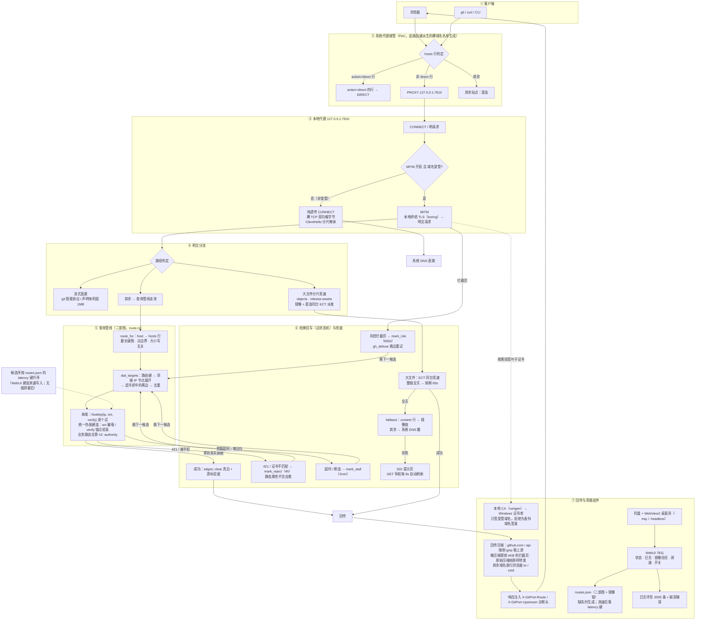
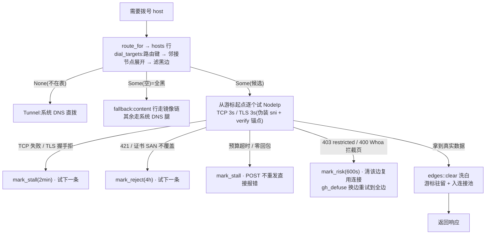

# 工作原理

从浏览器点开仓库到字节回到屏幕的完整链路:PAC 分流 → 代理入口 → 明文分流 → 查询管线(路由 v2 二部图) → 伪装统一建连 → 失败兜底 → 回传压缩。

> 路由 v2 的设计动机、openssl 实测证据与迁移记录见 [POOL-V2.md](POOL-V2.md);本文写运行时行为。

## 路由表 v2:二部图与边状态机

v1 的池/族/对口规则已全部退役,替换为一张数据表(`routes.json`)+ 一台边状态机。设计动机与 openssl 实测证据见 [POOL-V2.md](POOL-V2.md),手改指南见 [CONFIG.md](CONFIG.md)。

- **hosts 行(策略侧)**:域名键 → `action:"direct"`(本机直连)/ `content`(内容域熔断与短预算)/ `fallback`(dns 或 mirror)。**进不进 PAC 不需要单独字段**:非 direct 行自动进,运行时按路由键派生裸域名。最长键胜,`*.` 只认子域,点边界防误吞。
- **ips 节点(身份侧)**:IP(末段支持 `a-b` 范围展开,笛卡尔积上限 64)→ `sni`(骗墙的伪装域)+ `verify`(证书校验锚点,空 = 按目标 host 校验)+ `hosts`(声明服务哪些路由键)。**伪装身份与目标 host 解耦**——业务路由全靠 h2 `:authority`,所以一条连接可以混发多个 host 的流。
- **边状态机(运行时实测)**:表是预判,边是实测。`(IP, 路由键)` 三档坏态:421/证书不匹配 → 拉黑 4 小时(静态属性);超时/断连 → 降权 2 分钟(网络波动);风控拦截页 → 600 秒(对齐 GitHub 限流窗)。成功即清黑,坏边自愈的唯一通道。
- 触发条件刻意收窄:**业务状态码 403/404/429 一律不碰边**——那是 GitHub 在回答请求内容,不是"这个 IP 不服务这个 host"。

历史版本(v0.5.4 前)的直连白名单 4 域与真名分片白名单 10 域,已按 POOL-V2.md §8 的 openssl 实测全部入池:前者配 GLB / alambic 专节点 + 锚点,后者的 Fastly 组改走伪装锚点。`real` / `donor` / 借道记账整套退役。

## 串发拨号与边轮换

每个请求的拨号循环。**成功必须由数据层认证**——握手通不算,拿到真实数据才算;边状态(黑边滤网)在进循环前已经把冷却中的 (IP, 路由键) 剔除:

**轮换规则速查**:

| 触发事件 | 判定层 | 动作 |
|---|---|---|
| 拨号成功拿到真实数据 | 数据层 ok | edges::clear 洗白 + 游标驻留(主 / `_vice` 副通道各记各的) |
| 421 / 证书 SAN 不覆盖 | 服务端拒绝 | mark_reject,4 小时长冷却 |
| TCP 连不上 / TLS 握手失败 | 拨号层 | mark_stall,2 分钟短冷却 |
| 握手通但零回包 / 预算超时 | 数据层 noreply | mark_stall;POST 不重发不污账 |
| 403 restricted / 400 Whoa 拦截页 | 风控 | mark_risk,600s + 清该边复用连接(防乒乓) |
| 全部候选黑 | — | fallback:content 行走镜像链,其余走 DNS 腿;冷却 30s |
| 请求预算到期 | ctx 取消 | 只掐正在试的那条,不记黑不冷却 |
| 同 IP 重复驻留 | — | no-op:不写盘不打日志 |

与 v1 的对应关系:旧的"对口规则 / 池 / 族"由节点的 `hosts` 声明 + 边实测取代——**不对口不试不垫底**的语义还在,只是"对口"从代码里的族表变成了数据里的边。历史实测(白名单腿、真名分片)见 [ROUTING.md](ROUTING.md) 与 [POOL-V2.md](POOL-V2.md) §8。

## 连接复用

连接池的 key 是 **IP 节点**(伪装身份统一):**每个 IP 有且只有 1 条** h2 连接,**一条连接混发多个 host 的流**(h2 `:authority` 路由,业务身份与 TLS 身份解耦)。服务端视角"新建第一条"与"复用第一百条"不可区分——同 IP 同伪装身份同 `:authority`。第二条通道只能落在**另一个 IP** 上,同一个 IP 绝不并存两条:入库是唯一入口,同一把锁里发现该 IP 已有连接就把新拨的当场丢弃、返回池里现成的那条。

**为什么是两条(且必须分落两个 IP)**:GitHub 边缘按连接限并发——单连接 24 并发实测全部同一时刻返回(p50 = p95 = 1036ms),两条压到 **332ms**,四条不再改善。**但候选不足两个 IP 时不开第二条**:同一个 IP 拨第二次不会带来新通道,只会多一次握手,这时老实单通道。一条 GOAWAY 打断多 host 时,靠边状态机兜底。

**取用策略**:热路径 EWMA 实测耗时择优直接复用(`:authority` = 真实 host),两条质量接近(差不到 1.5 倍)时轮转各吃一半,差距明显才全押快的。冷路径分工更死:**主通道只开新坑**——凡是本 host 候选里已经有通道的 IP 一律跳过,按游标(`settings.json` 上次驻留)优先、失败再按实测延迟逐个串发;**副通道起跑前先查「本 host 候选 ∩ 已有通道」**,捡到现成的直接拿来用、请求不用等握手,捡不到才跟主通道一样串发。两条腿共享一张"谁试过哪个 IP"的圈,同一个 IP 只由一条腿试,绝不重复。

**拨号仲裁只管"要不要拨"这一件事、且只裁决共享 IP**:装表时按具体 IP 聚合它服务的路由键,挂了 2 个以上键或含 `*.` 通配键(一个键背后几十个 host)就算共享,标记跟着候选一起带出来。host 线程先查连接池,确实没有现成通道才申请。同一瞬间已经入批的申请算一批,按 **主站 > api > 一般内容 > avatars** 只放一个赢家,其余当场驳回换下一个 IP;晚一个节拍才到的按先到先得直接驳回,优先级更高也不反超。授权一直握到**通道入库**(h2 握手 + 写进连接池)才交棒,顺序不能反——中途松手会放进第二条。之后机器人不再管使用权,但留一条"这个 IP 已有通道"的登记:拨号循环和授权申请都在同一把锁里查它,谁也别想对这个 IP 再拨一次;多个 host 照旧复用池里那一条。最后一条连接被摘除时登记才撤销,此时才允许重拨。独占 IP 不进裁决,只保留"正在拨"轻量登记,但同样受"已有通道"约束。失败、panic、请求取消都自动交还;全部候选被占或已有通道时,让上层重查连接池,不空转。

**活跃窗口保活**:上游 h2 连接被边缘按空闲回收(实测 50-65 秒),跨导航会变成重新握手 1.3 秒。对策:有请求后每 30 秒对所有已缓存连接发 h2 PING 验活(不发 HTTP 请求、不触风控);静默 5 分钟自动停,空闲时零定时器。

**TLS 会话恢复**:重拨不再从零握手——按 SNI 形态缓存最近一张 session ticket(伪装腿一张管全族),重拨注入后走 1-RTT PSK:不重传、不验整条证书链,服务器拒绝时自动回落完整握手,无副作用。仅存内存,进程重启自然失效;不启用 0-RTT(重放面大)。

**起点记忆**(settings.json `lastIp`):每条非直连路由两把钥匙(主 / `_vice` 副键,对应双通道)。语义是**冷启动第一跳建议**——热路径不消费它(EWMA 择优直接复用),且是排序建议不是直通卡:必须先过黑边滤网才准排最前,旧功臣不能绕过新实测的坏边。复用成功也回写,起点跟着"最近功臣"漂移。

## 遥测拦截

GitHub 前端往 `api.github.com/_private/browser/*`（Datadog RUM）报性能与错误数据，另有 `alive.github.com` 心跳、`collector.github.com` 埋点——实测一次会话里这些占 api.github.com 上游请求的 **75%**（325/436），把搜索历史等真 API 挤在后面。

对策：这三类请求本地读掉请求体直接回 **204**，一个字节不发往 GitHub。拦截后 api.github.com 上游请求归零（只剩隧道解密记录），搜索 count 一批 300~450ms 完成。

## 压缩传输

`github.com` / `api.github.com` 强制上游 gzip（实测仓库页 327KB → 44.5KB），其余域名放行浏览器原生 br/zstd。拦截页嗅探边收边解压判前 4KB，已消费的原始压缩帧原样转发（不重压缩、不改 content-length）。

## 镜像链

覆盖 objects / release-assets 两族与 raw / gist / avatars / user-images / media 等图片文本域。github.com 的 `/releases/download` 路径归 release-assets 链；`/archive` 与 codeload 不进镜像，走主站池。CSS/JS 与 github.io 不过镜像（实测全 404）。

- **大文件域分片竞速**（objects / release-assets，支持 Range 的域）：段位总数 = 镜像数 + 2（**直连占两个槽位**，对应分落两个不同 IP 的主/副 h2 通道，镜像一家一个）。整包请求（无 Range）按空闲段位均分字节；下载器同时发多个 Range 时，把同一 URL 上在途区间的字节加总 ÷ 段位总数得到每段字节，按区间从大到小依次占位，大区间先拿、每个区间保底 1 段，避免几条连接各自切满一份把镜像挤爆。**不设最小切片尺寸**，文件再小也按段位切（最多切到一字节一段）。每个区间播完或客户端断开即注销登记，段位马上还回去。谁快谁多拿，慢段的尾巴按「接手划算才抢」的算术让给最快者（让位），停滞段收尸补发，交付线零缺口；候选全灭才失败
- **小文件域单请求单镜像**：avatars / raw / gist / media 串行逐家，单请求限前 5 家
- **ECT 时间槽派发**：选家 = (在途字节 + 新请求) ÷ 上一窗(500ms)实收，即「还需几个槽跑完」，最小者胜、无容差；并列看在途流数、再并列轮转。零历史按 +∞ 垫底（档内闲者先试）；有债零收 = 卡死清零，无债零收 = 空闲沿用旧值——三个 AtomicU64 + 一次除法，无 EWMA、无时间戳
- **链序**：种子快照序（随表演化，代码零内置）→ 图片链/codeload 链 UI「校准」重排（TTFB）→ 手改 routes.json（`mirrors_big` / `mirrors_small` 两字典，codeload 已归 small）；大文件域链序只作失败顺延次序，选家由 ECT 动态调度；codeload 直连优先
- 校准覆盖图片链与 codeload 链：逐镜像响应头测速（TTFB），host 间严格串行防测量污染；后台任务，关窗进托盘继续跑完。objects / release-assets 不校准——吞吐由真实下载流量按时间槽持续学习，比合成测速更真且零额外流量
- 镜像请求走共享连接池（每镜像 4 条空闲、60s 回收），批量加载/Range 续传不再逐次握手
- 整链全灭熔断 60s，窗口内同域毫秒级快速失败

## 大请求体与 git push（流式直通）

| 请求形态 | 走法 |
|---|---|
| `POST …/git-receive-pack` / `…/git-upload-pack` | 必流式（无论大小） |
| 声明 content-length > 1MB | 必流式 |
| 声明未超限、实际超了 | 缓冲转流式：已读前缀作首块续泵 |
| GET / HEAD / 小体 | 缓冲路径（可重放重试） |

关键语义：响应头一到立即交付客户端（上游拒了也要让客户端拿到真实响应）；客户端断开时泵弃流不补 EOS（git pack 尾带校验和，截断包必须被服务端拒）；单次尝试不重发；流式响应头预算 1800 秒。
