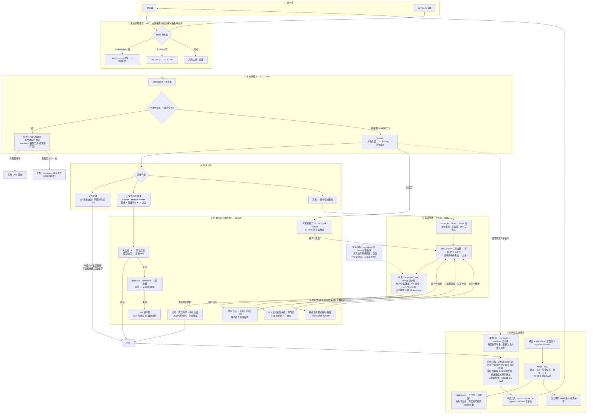
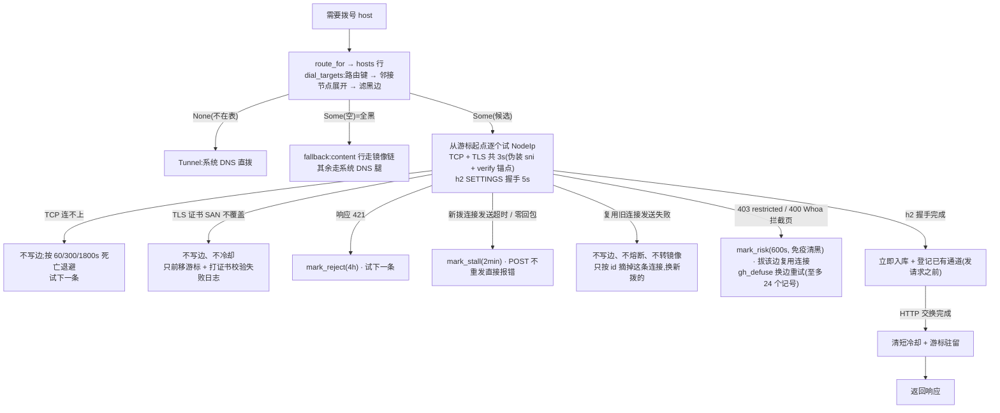

# 工作原理

从浏览器点开仓库到字节回到屏幕的完整链路:PAC 分流 → 代理入口 → 明文分流 → 查询管线(路由 v2 二部图) → 伪装统一建连 → 失败兜底 → 回传压缩。

> [ROUTING.md](ROUTING.md) 文末附录是 **v1 时代的历史实测存档**，判定逻辑已被 v2 取代，不要当现行依据；[CONFIG.md](CONFIG.md)「认 IP 速查」是 IP 段的实测标定，仍可参考 (原 POOL-V2.md 已随 v1 清理删除)。本文写运行时行为，以 `src/` 代码为准。

## 路由表 v2:二部图与边状态机

v1 的池/族/对口规则已全部退役,替换为一张数据表(`routes.json`)+ 一台边状态机。手改指南见 [CONFIG.md](CONFIG.md)。

- **hosts 行(策略侧)**:域名键 → `action:"direct"`(本机直连)/ `content`(内容域熔断与短预算)/ `fallback`(dns 或 mirror)。**进不进 PAC 不需要单独字段**:非 direct 行自动进,运行时按路由键派生裸域名。最长键胜,`*.` 只认子域,点边界防误吞。
- **ips 节点(身份侧)**:IP(末段支持 `a-b` 范围展开,笛卡尔积上限 64)→ `sni`(骗墙的伪装域)+ `verify`(证书校验锚点,空 = 按目标 host 校验)+ `hosts`(声明服务哪些路由键)。**伪装身份与目标 host 解耦**——业务路由全靠 h2 `:authority`,所以一条连接可以混发多个 host 的流。
- **边状态机(运行时实测)**:表是预判,边是实测。`(IP, 路由键)` 三档坏态:响应 **421** → 拉黑 4 小时(静态属性);**新拨连接**发送超时/断连 → 降权 2 分钟(网络波动);风控拦截页 → 600 秒(对齐 GitHub 限流窗)。**写边只发生在响应处理层,拨号层一次都不写**:TLS 证书校验失败(SAN 不覆盖)不记边、不冷却,只前移游标并打一行 `证书校验失败` 日志;TCP 连不上也不写边,走 60/300/1800 秒的死亡退避。**成功只清短冷却(超时/421),风控冷却免疫清黑、只随时间过期**——风控页本身就是一次"成功"的 HTTP 交换,可清就会在风暴里被并发回写当场洗掉(实测:26 家候选 3 轮就回头的事件根因)。
- 触发条件刻意收窄:**业务状态码 403/404/429 一律不碰边**——那是 GitHub 在回答请求内容,不是"这个 IP 不服务这个 host"。

历史版本(v0.5.4 前)的直连白名单 4 域与真名分片白名单 10 域,已按 2026-11-03 的 openssl 实测全部入池:前者配 GLB / alambic 专节点 + 锚点,后者的 Fastly 组改走伪装锚点。`real` / `donor` / 借道记账整套退役。

## 串发拨号与边轮换

每个请求的拨号循环。**握手通不算完成,HTTP 交换完成(收到响应)才算**——这层看不见响应是不是风控页,所以风控冷却做成免疫清黑、只随时间过期;边状态(黑边滤网)在进循环前已经把冷却中的 (IP, 路由键) 剔除:

**轮换规则速查**:

| 触发事件 | 判定层 | 动作 |
|---|---|---|
| HTTP 交换成功拿到真实数据 | 响应层 | h2 握手完成即已入库;此处清短冷却 + 游标驻留(主 / `_vice` 副通道各记各的;风控冷却例外) |
| 响应 421 | 响应层 | mark_reject,4 小时长冷却 |
| TLS 证书 SAN 不覆盖 | 拨号层 | **不写边、不冷却**,只前移游标 + 打日志;那是本地校验没过,不是对端拒绝 |
| TCP 连不上 / 被拒 / RST | 拨号层 | **不写边**,按 60/300/1800 秒死亡退避 |
| 新拨连接发送超时 / 断连 | 响应层 | mark_stall,2 分钟短冷却;POST 不重发不污账 |
| 复用旧连接发送失败 | 响应层 | **不算直连失败**:只摘该连接、本次后续只走新拨连接;不记边、不熔断、不转镜像 |
| 403 restricted / 400 Whoa 拦截页 | 风控 | mark_risk,600s 免疫成功清黑 + 拔该边复用连接(防乒乓);gh_defuse 换边重试至多 24 个记号 |
| 全部候选黑 | — | fallback:content 行走镜像链,其余走 DNS 腿;冷却 30s |
| 串发总预算 20s 耗尽 | 预算层 | 按 host 冷却,只掐正在试的那条,不记黑不写边 |
| 同 IP 重复驻留 | — | no-op:不写盘不打日志 |

与 v1 的对应关系:旧的"对口规则 / 池 / 族"由节点的 `hosts` 声明 + 边实测取代——**不对口不试不垫底**的语义还在,只是"对口"从代码里的族表变成了数据里的边。历史实测(白名单腿、真名分片)见 [ROUTING.md](ROUTING.md) 附录。

## 连接复用

连接池的 key 是 **IP 节点**(伪装身份统一):**每个 IP 有且只有 1 条** h2 连接,**一条连接混发多个 host 的流**(h2 `:authority` 路由,业务身份与 TLS 身份解耦)。服务端视角"新建第一条"与"复用第一百条"不可区分——同 IP 同伪装身份同 `:authority`。第二条通道只能落在**另一个 IP** 上,同一个 IP 绝不并存两条:入库是唯一入口,同一把锁里发现该 IP 已有连接就把新拨的当场丢弃、返回池里现成的那条。

**为什么是两条(且必须分落两个 IP)**:GitHub 边缘按连接限并发——单连接 24 并发实测全部同一时刻返回(p50 = p95 = 1036ms),两条压到 **332ms**,四条不再改善。**但候选不足两个 IP 时不开第二条**:同一个 IP 拨第二次不会带来新通道,只会多一次握手,这时老实单通道。一条 GOAWAY 打断多 host 时,靠边状态机兜底。

**取用策略(门房打分)**:连好之后不按固定份数摊派,也不看「差不到 1.5 倍就轮转各吃一半」——代码里没有这条。每条连接记在途流数和服务端 `SETTINGS_MAX_CONCURRENT_STREAMS` 下发的上限,分数 = (在途 + 1) ÷ 上限 × EWMA 延迟,取最小;闲着又快的优先享用,顶到上限的让给另一条。**两条通道都参与打分、都承载并发**,只有搜索类请求固定骑主通道那条;全满时按分数最小者给 h2 自己排队。

**拨号阶段的主副分工**(与上面的取用是两件事,别混):`plan_legs` 里**主腿只开新坑**——凡是本 host 候选里已经有通道的 IP 一律跳过,按游标(`settings.json` 上次驻留)优先、失败再按实测延迟逐个串发;**副腿起跑前先查「本 host 候选 ∩ 已有通道」**,捡到现成的直接拿来用、请求不用等握手,捡不到才跟主腿一样串发。两条腿共享一张"谁试过哪个 IP"的圈,同一个 IP 只由一条腿试,绝不重复。分工只管「谁来拨」,连好之后两条通道照旧一起承载并发。

**三类 host 各有规矩**:内容域开双通道,取用按「占用率 × 延迟」挑最闲又快的那条——每条连接记着服务端 `SETTINGS_MAX_CONCURRENT_STREAMS` 下发的上限和在途流数,顶到上限的让给另一条,不再只看谁快;会话域固定单通道单 IP,建连先自己按候选串发拨一条(连接上记着 `owner`),全部试完或候选全被占才复用公共通道;大文件域(objects / release-assets)和 12 个不值得养专属通道的子域(只去 Fastly 边缘的 docs / support / resources / desktop / pages / skills / archiveprogram / socialimpact / raw.github.com / agent,加超低频的 uploads / api.mcp)也是单通道,但复用现成的优先、自建只是兜底。

**拨号仲裁只管"要不要拨"这一件事、且只裁决共享 IP**:装表时按具体 IP 聚合它服务的路由键,挂了 2 个以上键或含 `*.` 通配键(一个键背后几十个 host)就算共享,标记跟着候选一起带出来。host 线程先查连接池,确实没有现成通道才申请。同一瞬间已经入批的申请算一批,按 **主站 > api > 一般内容 > avatars** 只放一个赢家,其余当场驳回换下一个 IP;晚一个节拍才到的按先到先得直接驳回,优先级更高也不反超。授权一直握到**通道入库**才交棒——顺序是 `h2 握手 → store_h2 写进连接池 → drop(claim) 放开拨号权`,发请求在入库之后;中途松手会放进第二条。独占 IP 不进裁决,只保留"正在拨"轻量登记。失败、panic、请求取消都自动交还。

**「已有通道」登记与池锁原子化**:池里增删连接和 `inflight::live` 的登记/撤销都在**同一把池锁内**完成(`store_h2` 里 `mark_live`、`drop_h2_id` 里 `unmark_live`),不存在「池里摘了、表里还挂着」或「表里复活一条已摘连接」的交错。拨号循环据此不再对同一个 IP 拨第二次;多个 host 照旧复用池里那一条。最后一条连接被摘除时登记才撤销,此时才允许重拨——连接自己断掉也算摘除:驱动任务结束即按 id 自行除名,不必等下一次请求撞见死连接。

**拨号锁范围**:per-host 拨号锁只罩「查池 + 拨号」这一段,发送(`send_once`)之前就放掉;外层锁只罩「排队等拨号 + 等完重查池」。以前把整条 HTTP 交换攥在锁里,85 个请求被串行化成 40 秒以上,现在不会了。全部候选被占或已有通道时(`ERR_NO_FREE_IP`),在 **3 秒内每 50ms** 重查连接池,等并行建连把连接入库后直接复用现成的;超时才交兜底,流式请求不等立即交兜底。

**批次化通道 / 按需验活**:上游 h2 连接被边缘按空闲回收(实测 50-65 秒),通道不再当成需要续命的长期资产:**每条连接自带一个驱动任务**(`ConnDriver`)只做两件事——持续 poll conn 让 h2 帧收发活着(h2 协议的硬要求,不是保活),以及连接结束时按 id 自摘并撤销「已有通道」登记;没有定时器、没有 PING、没有补拨。通道的可用性由**最近一次请求**定义:批窗(30s,约为边缘回收窗的一半)内复用,过窗视同不存在——取用前 `evict_stale` 把过窗且空闲(无在途流)的就地除名,「下批重建」由此落地(不先摘,`store_h2` 会把新拨的当场作废、拨号订单也会被「已有通道」驳回);批内通道**不做任何活性检查**,死了由请求结果兜底(只摘连接不罚 IP,挪游标让下一个请求换家)。会话域是唯一例外:通道是**带健康闸的长期资产**(同 IP 保住会话,风控面不漂移)——闲置超过 10s 先 ping 验活(`session_pick` 经驱动任务代答,2s 没等到 PONG 判死摘除,游标钉着原 IP 重拨落回原家),刚用过的直接信。机器睡眠不再需要专门机制:醒来后所有通道都过了批窗,第一个请求自然清场;会话域由 ping 闸发现死亡。代价是每次导航 ≈ 每 host 两条腿的重新握手(30s 内的连续导航免掉),由 per-host 拨号锁与拨号仲裁压着并发。

**TLS 会话恢复**:重拨不再从零握手——按 SNI 形态缓存最近一张 session ticket(伪装腿一张管全族),重拨注入后走 1-RTT PSK:不重传、不验整条证书链,服务器拒绝时自动回落完整握手,无副作用。仅存内存,进程重启自然失效;不启用 0-RTT(重放面大)。

**起点记忆**(settings.json `lastIp`):每条非直连路由一把主键;只有内容域再加一把 `_vice` 副键(双通道各记各的),会话域固定单通道、不记副键。语义是**冷启动第一跳建议**——热路径不消费它(EWMA 择优直接复用),且是排序建议不是直通卡:必须先过黑边滤网才准排最前,旧功臣不能绕过新实测的坏边。复用成功也回写,起点跟着"最近功臣"漂移。

## 遥测拦截

GitHub 前端往 `api.github.com/_private/browser/*`（Datadog RUM）报性能与错误数据，另有 `alive.github.com` 心跳、`collector.github.com` 埋点——实测一次会话里这些占 api.github.com 上游请求的 **75%**（325/436），把搜索历史等真 API 挤在后面。

对策：这三类请求本地读掉请求体直接回 **204**，一个字节不发往 GitHub。拦截后 api.github.com 上游请求归零（只剩隧道解密记录），搜索 count 一批 300~450ms 完成。

## 压缩传输

`github.com` / `api.github.com` **且客户端声明接受 gzip** 时才强制上游 gzip（实测仓库页 327KB → 44.5KB）；客户端没声明或明确 `q=0` 不强制，其余域名放行浏览器原生 br/zstd。拦截页嗅探边收边解压判前 4KB，已消费的原始压缩帧原样转发（不重压缩、不改 content-length）。

## 镜像链

覆盖 objects / release-assets 两族与 raw / gist / avatars / user-images / media 等图片文本域。github.com 的 `/releases/download` 路径归 release-assets 链；`/archive` 与 codeload 不进镜像，走主站池。CSS/JS 与 github.io 不过镜像（实测全 404）。

- **大文件域分片竞速**（objects / release-assets，支持 Range 的域）：镜像一家一个段位；**整包请求（客户端无 Range）里直连以 `direct/{chain_host}` 身份入列两次**，对应主/副两条 h2 通道各领一段——所以直连是两份，不是一份。段数 = 空闲段位数，逐段按段位表轮流派发。下载器同时发多个 Range 时，把同一 URL 上在途区间的字节加总 ÷（镜像数 + 1）得到每段字节，按区间从大到小依次占位，大区间先拿、每个区间保底 1 段，避免几条连接各自切满一份把镜像挤爆。**不设最小切片尺寸**，文件再小也按段位切（最多切到一字节一段）。每个区间播完或客户端断开即注销登记，段位马上还回去。谁快谁多拿，慢段的尾巴按「接手划算才抢」的算术让给最快者（让位），停滞段收尸补发，交付线零缺口；候选全灭才失败
- **小文件域单请求单镜像**：avatars / raw / gist / media 串行逐家，单请求限前 5 家
- **ECT 时间槽派发**：选家 = (在途字节 + 新请求) ÷ 上一窗(500ms)实收，即「还需几个槽跑完」，最小者胜、无容差；并列看在途流数、再并列轮转。零历史按 +∞ 垫底（档内闲者先试）；有债零收 = 卡死清零，无债零收 = 空闲沿用旧值——每面镜像 5 个原子量（在途字节/在途流数/本窗字节/上窗字节/失败截止）+ 1 个并列轮转计数，500ms 窗口由独立线程推进，无 EWMA、无时间戳
- **链序**：种子快照序（**默认双字典为空，全新安装一个镜像都没有**）→ 图片链 UI「校准」重排（TTFB）→ 手改 routes.json（`mirrors_big` / `mirrors_small` 两字典）；大文件域链序只作失败顺延次序，选家由 ECT 动态调度
- 校准只覆盖图片链：逐镜像响应头测速（TTFB），host 间严格串行防测量污染；后台任务，关窗进托盘继续跑完。objects / release-assets 不校准——吞吐由真实下载流量按时间槽持续学习，比合成测速更真且零额外流量。**codeload 已迁池**，校准模板里那条 codeload 链是迁池后的残留，镜像链只按内容域白名单建键、装载时丢弃，模板永不触发
- 镜像请求走共享连接池（每镜像 4 条空闲、60s 回收），批量加载/Range 续传不再逐次握手
- 整链全灭熔断 60s，窗口内同域毫秒级快速失败

## README 大图：纯直连多段（与镜像链正交）

`master_route` 判为 **Pool** 的静态图片域请求，在进 `get_direct` 之前先过一遍 `mitm/direct_split.rs`。它和上面的「大文件分片竞速」不是一回事：那边按镜像源分派段位、走 ECT 记账与跨源补发；这边**只认池里现成的伪装 SNI 直连连接**，一个字节都不经过 gh-proxy。

- **准入**：GET、客户端没带 Range、host 在七个静态图片 CDN 白名单内（raw / user-images / private-user-images / media / camo / gist / avatars）、内容域熔断未开、池里得有现成的直连连接。会话域 `github.com` / `api.github.com` 本就不在白名单里，README 的 `/owner/repo/raw/...` 第一跳是 302，天然不参与。**准入只看请求形状和 host，不看有没有凭据**——带签名或登录态的图也照切。
- **探片**：发 `Range: bytes=0-0`，拿 `Content-Range` 总长与 `Content-Type`。≥512KB 且是 `image/*` 才切；结果按 URL 记 10 分钟，上游忽略 Range 或非图片记「不可切」不再白探。
- **段数与派发**：按总长 ≈192KB 一段，钳在 4~8 段。每段一个 `Range`，由 `cached_h2_in` 按占用率×延迟打分挑连接（不绑定 IP，也**不新拨连接**）；池冷就整体退回单流，让主路径自己拨号。**URL 查询串与 Cookie / Authorization / Proxy-Authorization 原样保留**——签名可能在 query 里、凭据可能在 Authorization 里，剥掉只会把请求改坏（403 / 签名校验失败）；段请求只换 Range，并剥掉会改变段语义的头（原始 Range、If-Range / If-None-Match / If-Modified-Since、Accept-Encoding、逐跳头与 body 相关头）。带 `jwt` / `sig` / `X-Amz-Credential` 的 URL 一个字不动地跟着 8 个段请求发出去。
- **合并**：只有**所有**段都回 206、且 `Content-Range` **起点等于本段 `s`、终点不越过本段末端**，才组装 200 响应（`content-length` = 总长，搬 `content-type` / `etag` 等头、剥逐跳头），body 按段序交付；补发段用同一套校验。单段 body 读到的字节超出自己那份预算会直接报错，不让多出来的尾巴吃掉全局总长；响应体总长仍按 `content-length` 截断（设计内保护）。每轮 poll 所有段，避免未读的段把 h2 连接级流控窗口占死。任一段失败就丢弃全部段响应、交回单流，不会出现「头已发出、图却花掉」。
- **闸**：同时在途的多段响应最多 3 个（挂在响应体生命周期上自动归还），单段用户态缓冲 2MiB、段响应头预算 8s，一页十几个 `` 一起到也不会把连接窗口打满。

实测依据（人工实测，非单元测试断言）：2026-11-05 同一文件、同样字节、只走代理直连腿，1MB 单流 73.8s / 8 段 45.0s，反序热连接 512KB 单流 48.6~56.5s / 8 段 20.9s。2026-11-06 带 `jwt` / `sig` / `X-Amz-Credential` 查询串的 1,608,296B 大图：8 段 41.17s、单流 69.21s，两者 sha256 一致，日志确认无镜像、无熔断、无新拨连接。瓶颈在单条 h2 stream 那一层而非 TCP 拥塞窗口，所以段不必落在不同的 IP 上，风控暴露面也不随段数增长。注意 raw CDN 不校验签名，实测证明的是「签名形态的 query 不会被丢、8 段能切、合并字节一致」，不等于「真 jwt 被服务端接受并发 Range」；凭据头与 query 的保留由单元测试钉住。

## 大请求体与 git push（流式直通）

| 请求形态 | 走法 |
|---|---|
| `POST …/git-receive-pack` / `…/git-upload-pack` | 必流式（无论大小） |
| 声明 content-length > 1MB | 必流式 |
| 声明未超限、实际超了 | 缓冲转流式：已读前缀作首块续泵 |
| GET / HEAD / 小体 | 缓冲路径（可重放重试） |

关键语义：响应头一到立即交付客户端（上游拒了也要让客户端拿到真实响应）；客户端断开时泵弃流不补 EOS（git pack 尾带校验和，截断包必须被服务端拒）；单次尝试不重发；流式响应头预算 1800 秒。
