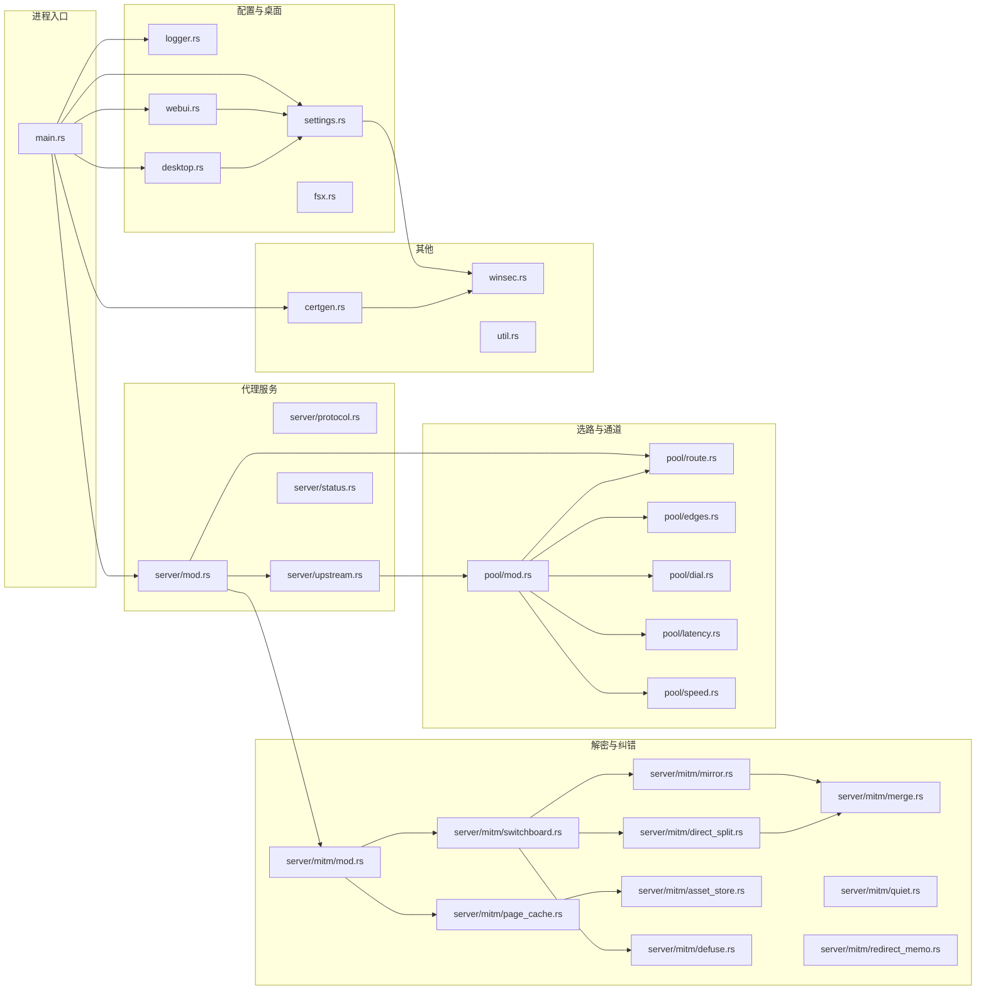
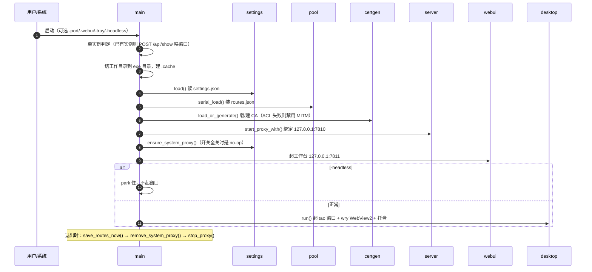
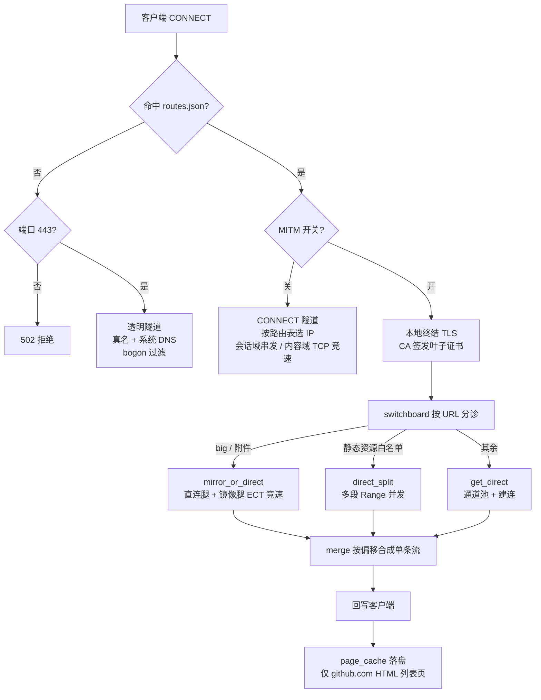
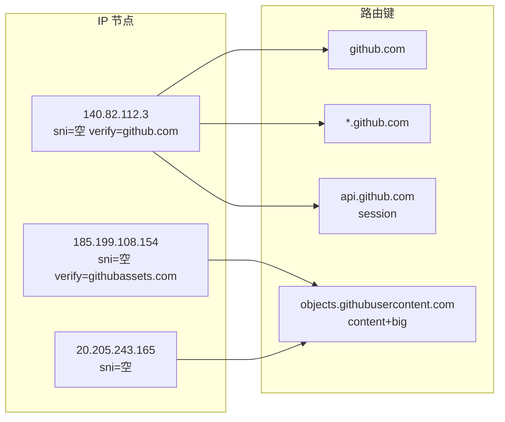
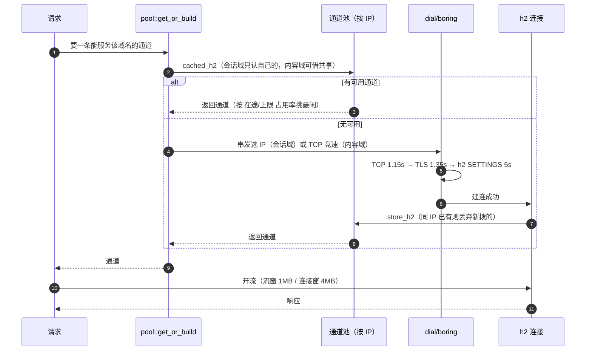
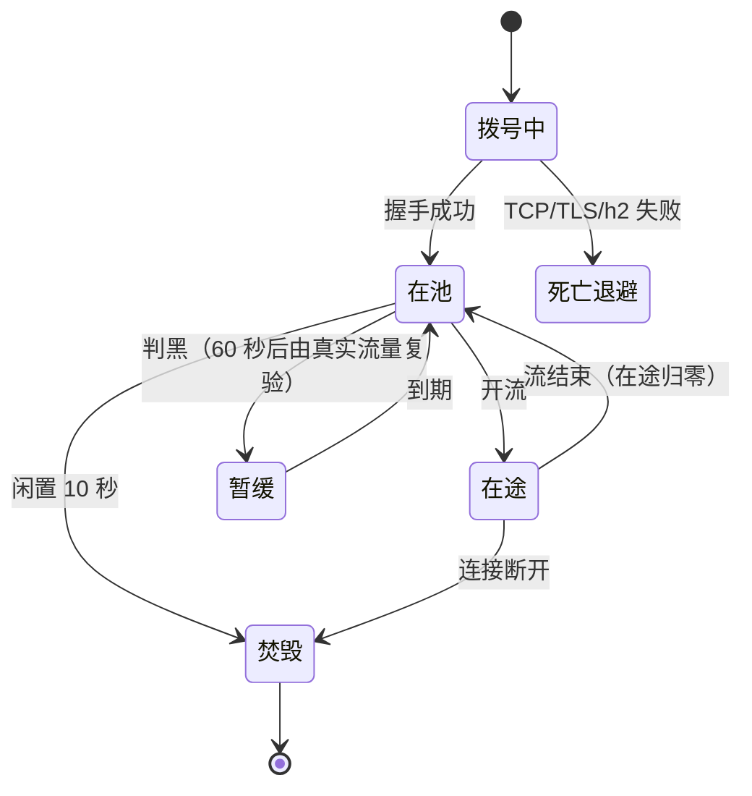
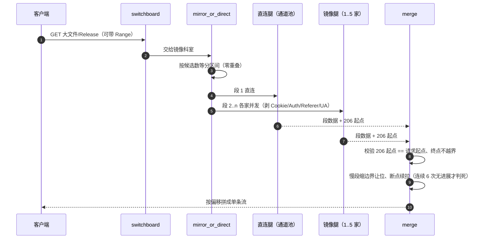
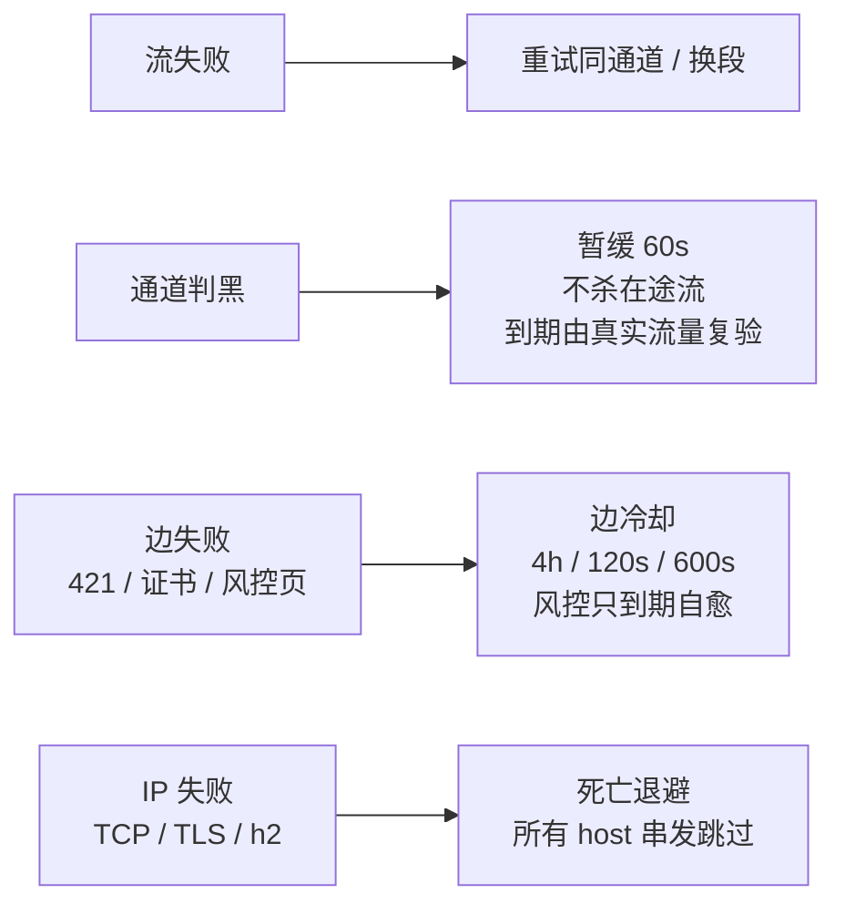
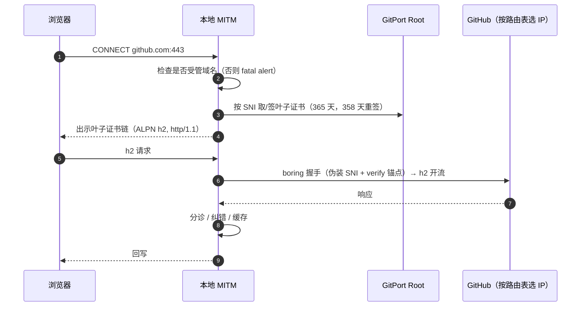
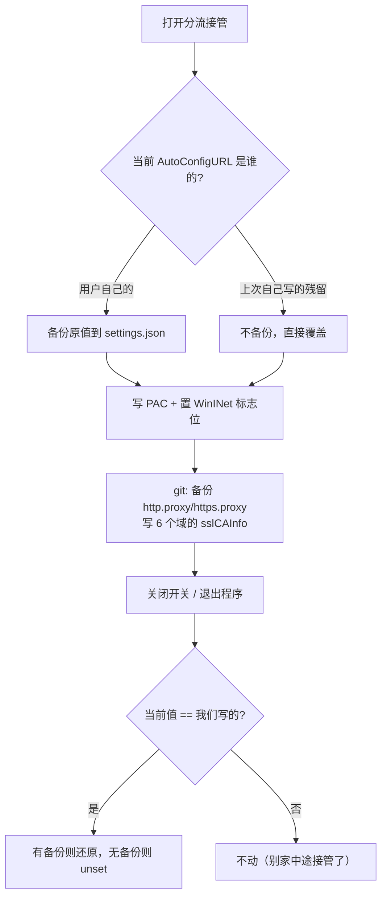

# 技术文档

面向要读这份代码的人：先看结构，再看数据流，最后看每张文件表。

> 行号会随代码漂移，文档里的引用以文件与函数名为准。

---

## 1. 模块关系



`util.rs` 是最底层（日志回调、毫秒时间、锁自愈），不依赖任何业务模块；`protocol.rs` 是两个子系统的公共类型（`BoxBody`、请求预算），让 `mitm` 与 `upstream` 不必互相引用实现。

## 2. 启动时序



## 3. 一次请求怎么分流



分诊的"谁去哪个科室"只写在 `server/mitm/switchboard.rs`；`mitm/mod.rs` 只管缓冲与响应善后（缓存失效、写路由）。这是刻意的分层。

## 4. 路由表是一张二部图



- 边 = 节点 `hosts` 列表里出现该键。**没有边就不能服务**，这是数据约束，不是运行时判断。
- `session` 键（`github.com`、`*.github.com`、`api.github.com`）走"固定同一 IP、不开第二条通道"。
- `content`/`big` 键可竞速、可切片、可挂镜像链。
- `direct` 键不进代理，直接进 PAC 的 DIRECT 名单。

边还带状态：`pool/edges.rs` 存 `(ip, 域名键) → 冷却到期时刻`，三档冷却（421/证书不匹配 4 小时、超时 120 秒、风控页 600 秒），风控冷却只能到期自愈。

## 5. 通道池与拨号



通道生命周期：



关键约束：**每 IP 恒 1 条通道**（会话域与内容域都是 1）；候选 IP 全占时不开溢出通道，骑在满载通道上排队，由 h2 服务端配额兜。

## 6. 镜像 + 切片 + 合并



三条要说清的边界：

1. 合并层**只按偏移校验**，不比内容。
2. `split_even` 是等分零重叠，段可缩不可重叠。
3. 镜像链上限 5 家，硬错误降权 45 秒、超时降权 15 秒；全败才回落直连。

## 7. 失败分级



四层的区别在于"影响面"：流影响一次请求，通道影响一条 IP 上的所有键，边影响某个 (IP, 域名) 组合，IP 影响全部域名。混用会出两种事故——把抖动当死亡（永久踢掉好 IP），或把风控当成功（并发把冷却洗掉）。

## 8. MITM 的 TLS 面



- 只为受管域名签发；SNI 不在表内直接 `ALERT_FATAL`。
- 会话票据与缓存禁用（schannel 的恢复票据与本服务端互操作会报 bad record MAC）。
- `ca.key` 权限收紧失败 → 删私钥、禁用 MITM，不降级硬跑。

## 9. 系统写入与还原



三条判定缺一不可：认出自己的（`lastPAC` 精确比较）、放过别人的（当前值不是自己写的就不动）、有备份优先还原。git 侧同理，只写 URL 作用域的键，不碰全局 `sslVerify`。

## 10. 目录结构与各文件职责

```
gitport-github/
├─ Cargo.toml              依赖与 release profile（fat LTO、strip）
├─ build.rs                Windows 资源（图标、版本信息）
├─ .cargo/config.toml      BoringSSL 构建约定（clang-cl / Ninja / nasm / 工具集路径）
├─ assets/
│   ├─ app.rc              资源脚本
│   └─ icon.ico            托盘与窗口图标
├─ tools/                  排障脚本（缓存检查、变体对比、计时探针），非基准测试
├─ docs/
│   └─ architecture.md     本文件
└─ src/
   ├─ main.rs              启动顺序、命令行参数、退出钩子
   ├─ config.rs            端口与全部超时/阈值常量、内容域域名表
   ├─ certgen.rs           本地 CA：生成/加载、叶子签发、装当前用户根
   ├─ settings.rs          开关持久化、PAC 接管/还原、git 接管/还原、自启、镜像注册表
   ├─ webui.rs             工作台：静态页、状态/日志接口、PAC 生成、开关接口
   ├─ desktop.rs           tao 窗口 + wry(WebView2) + 托盘、单实例 mutex
   ├─ logger.rs            环形日志（2000 条）+ crash.log / tray.log
   ├─ fsx.rs               原子写盘（临时文件 + rename）
   ├─ winsec.rs            ca.key / settings.json 的 DACL 收紧
   ├─ util.rs              LogFn、now_ms、锁中毒自愈
   ├─ pool/
   │   ├─ route.rs         二部图装载与键匹配、PAC 名单、master_route 分诊
   │   ├─ edges.rs         边状态机：(ip,键) 冷却
   │   ├─ mod.rs           取通道入口 get_or_build、串发/竞速、死亡退避、种子表
   │   ├─ dial.rs          TCP/TLS 握手执行器（boring：Chrome 指纹、SNI 与校验名解耦）
   │   ├─ latency.rs       建连延迟表（实测回流，落 routes.json）
   │   ├─ speed.rs         通道暂缓与换血账本（60s 复验、60s 重建冷却）
   │   └─ seeds.json       内嵌最小路由表（只做首启引导与补边）
   ├─ server/
   │   ├─ mod.rs           监听、CONNECT 分流、明文 HTTP、bogon 过滤、隧道
   │   ├─ protocol.rs      BoxBody/Incoming 类型与请求预算
   │   ├─ upstream.rs      h2 通道：池、配额、选路、请求/响应
   │   ├─ status.rs        30s 通道账本（在途/上限、暂缓剩余）
   │   └─ mitm/
   │       ├─ mod.rs       MITM 主流程：缓冲、善后、缓存失效、写路由
   │       ├─ switchboard.rs  URL 级分诊（唯一政策点）
   │       ├─ mirror.rs    镜像链、ECT 竞速、身份头剥除、失败降权
   │       ├─ direct_split.rs 直连多段（媒体白名单）
   │       ├─ merge.rs     段合并、让位、补发、偏移校验
   │       ├─ page_cache.rs 页面缓存（列表页/首页骨架 + 白名单 XHR；仓库页零转换直出，html 永不缓存）
   │       ├─ asset_store.rs githubassets 资产库（immutable 资产一存永逸，本地透明回放，时代中立）
   │       ├─ defuse.rs    风控页识别（403 restricted / 400 Whoa）与换 IP
   │       ├─ redirect_memo.rs 头像 302 记忆（6 小时 TTL）
   │       └─ quiet.rs     日志降噪（同 host 只留首条 / 按分钟聚合）
   └─ tests/               对齐各模块的单元与集成测试
```

## 11. 建议的读码顺序

1. `main.rs` → `config.rs`：先知道进程起来了什么、有哪些硬阈值。
2. `pool/route.rs` → `pool/mod.rs` → `server/upstream.rs`：路由图怎么变成一条连接。
3. `server/mod.rs`：CONNECT 的四条出口。
4. `server/mitm/mod.rs` → `switchboard.rs`：解密后按 URL 分诊。
5. `mirror.rs` → `direct_split.rs` → `merge.rs`：内容域的三件套。
6. `settings.rs`：系统写入与还原的判定（这里出错最容易被用户察觉）。
7. `certgen.rs` + `winsec.rs`：安全边界。

## 12. 改代码前必须知道的不变量

1. 每 IP 恒 1 条通道；会话域固定同一 IP、不开第二条。
2. 通道闲置 10 秒焚毁——这是替代探活的机制，不要加回探活。
3. 段合并只按偏移校验，不按内容；任何"镜像内容可信"的假设都不成立。
4. 镜像请求必须剥身份头（Cookie/Authorization/Referer/UA）。
5. 系统写入必须能认出"是不是自己写的"，否则还原会改坏用户配置。
6. CA 只为受管域名签发；ACL 收紧失败必须禁用 MITM。
7. 代理只绑 `127.0.0.1`；非受管域名只放行 443。
8. 风控冷却只能到期自愈，不能 `clear()`。
9. 仓库页 html 永不缓存且零转换直出；资产库逐 URL 回放、时代中立（URL 即内容指纹）——跨发版冻结/换装资产引用会让旧 JS 配新数据白屏（实测），禁止回加。

## 13. 改动影响面

| 想改 | 牵动 | 容易漏 |
| --- | --- | --- |
| 路由语义 | `pool/route.rs`、`routes.json` 兼容、PAC 名单 | `HostMeta`/`IpNode` 回写格式 |
| 通道策略 | `config.rs` 常量、`get_or_build`、`status.rs` | 常量是架构不是旋钮 |
| 镜像 | `mirror.rs` 校验与降权、`merge.rs` 段边界 | 新增信任假设必须同时给校验手段 |
| 缓存 | `page_cache.rs` 键与目录、清盘阈值；`asset_store.rs` 收录门 | 键含会话身份，跨账号串页是硬伤；禁止回加"html 缓存/引用冻结"（白屏教训，见 CACHE.md） |
| 系统写入 | `settings.rs` 备份/还原判定 | "只还原自己写的"不能松 |
| CA | `certgen.rs` 签发范围、`winsec.rs` ACL | ACL 失败必须禁用 MITM |
