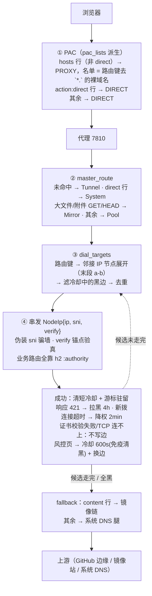

# 路由（v2 二部图）

> 判定逻辑唯一真相:`src/pool/route.rs`(route_for / dial_targets / master_route)+ `routes.json`(ips / hosts / mirrors_big / mirrors_small)。
> **文末附录整体是 v1 历史存档，不是现行依据**：池/族/对口规则、真名分片腿、`POOL_ROUTES`、白名单腿、`real`/`donor` 标志均已退役，附录里的路由判定结论（含 objects-origin、codeload、白名单腿）**已被 v2 推翻**；只有 IP 死活与镜像质量的观察还有参考价值。正文以 `src/` 代码为准。

## 0. 总览



一句话版:**PAC 决定谁进代理;master_route 决定进代理后直连还是镜像;dial_targets 决定用哪些 IP(边状态机实时剔坏);兜底决定全灭之后找谁。**

## 1. ① PAC:路由键派生的裸域名名单

PAC 由 `pool::pac_lists()` 生成:非 direct 行进 PROXY 名单,`action:"direct"` 行进 DIRECT 名单,表外域名 DIRECT。**名单值 = 路由键去 `*.` 的裸域名,运行时派生、不在 routes.json 落盘**；`pac` 字段已从数据结构移除,写进 JSON 也不会被读取(未知字段直接忽略)——想让某行不进 PAC,用 `action:"direct"`。

**与 v1 的关键差异**:v1 有 4 个域名(objects-origin / uploads / viewscreen / api.mcp)走 PAC DIRECT 绕过代理;v2 起它们全部入池——各配专节点与证书锚点(viewscreen / objects-origin / api.mcp → GLB 族 `140.82.112-114.21-22`,verify=`actions.githubusercontent.com`;uploads → alambic `20.205.243.161`,verify=`githubusercontent.com`),伪装握手 openssl 实测全通过(2026-11-03)。当前受管域名全部进代理;路由键数量由 `seeds.json` 的 `hosts` 行加节点声明推导,会随表变化,不写死数字。

匹配语义:裸键含自身+任意级子域,`*.` 只认子域(裸域不命中),最长键胜,点边界(`evilgithub.com` 不命中 `github.com`),大小写无关。

## 2. ② master_route

| 请求 | 路由 | 说明 |
|---|---|---|
| 未命中任何 hosts 行 | **Tunnel** | 系统 DNS 直拨(纯隧道,如 update.googleapis.com 经代理的流量) |
| `action:"direct"` 行 | **System** | 本机直连,不进代理管线(当前 routes.json 无此行) |
| GET/HEAD + objects / release-assets 域,或 github.com 的 `/releases/download`、`/releases/latest/download` 路径 | **Mirror** | 分片竞速(派发细节见 [ARCHITECTURE.md](ARCHITECTURE.md) 镜像链节) |
| GET + 静态图片 CDN（raw / user-images / private-user-images / media / camo / gist / avatars）的 README 大图 | **Pool**（不进 Mirror） | 探片后纯直连切 4~8 段并发 Range、按字节边界合流；小图/非图片/池冷自动退回单流。见 [ARCHITECTURE.md](ARCHITECTURE.md)「README 大图」节 |
| 其余(含 codeload——按子域命中 `github.com` 裸键) | **Pool** | 查询管线走二部图 |

codeload 与 archive 的变化:**codeload 并入池**——`master_route` 里没有 codeload 专属分支,它作为 `github.com` 的子域按点边界命中 `github.com` 裸键走 `Pool`,直连全灭后走所有 Pool 域通用的 `dns_direct_fetch` 系统 DNS 兜底,不是 codeload 专属兜底,也不按校准链序逐家。`mirrors_small` 里的 codeload 校准模板是迁池后的残留:镜像链只按内容域白名单建键、装载时丢弃非白名单链,那条模板永不触发。`/archive` 源码包不再镜像——镜像链归属只剩 objects / release-assets 两族。

## 3. ③ dial_targets:二部图查询与边状态机

`dial_targets(host)` 五步:route_for 定行 → 路由键查反向索引 → 节点 IP 展开(`140.82.112-114.3-4` = 6 IP,笛卡尔积上限 64)→ 滤黑边 → 去重,产出 `NodeIp{ip, sni, verify}`。

- **sni**:骗墙的伪装域(当前全线 `baidu.com`),与目标 host 无关——墙只看 ClientHello 明文,业务路由在加密的 h2 `:authority` 里
- **verify**:证书校验锚点,只求证明"对面是真 GitHub";留空 = 按目标 host 校验(安全默认)
- **边状态机**:表是预判,边是实测,`写边只发生在响应处理层,拨号层一次都不写`。(IP, 路由键) 三档坏态——**响应 421** 拉黑 **4h**(静态属性不会自愈)、**新拨连接**发送超时/断连降权 **2min**(网络波动)、风控拦截页冷却 **600s**(对齐 GitHub 限流窗),**免疫成功清黑**——风控页本身就是一次"成功"的 HTTP 交换,可清就会在风暴里被并发回写洗掉(实测 26 家候选 3 轮回头的事件根因);成功只清短冷却。**TLS 证书 SAN 不覆盖不记边、不冷却**,只前移游标并打一行 `证书校验失败`(本地校验没过,不是对端拒绝);**TCP 连不上也不写边**,走 IP 级 60/300/1800 秒死亡退避;**TLS 握手超时**(TCP 过了、对端对 ClientHello 装死)也不写边,走节点级(`ip|sni`)60/300/1800 秒死亡退避——ClientHello 的 SNI 由节点配置决定,与触发请求的 host 无关,全 host 共享跳过。业务状态码 403/404/429 **不碰边**——那是 GitHub 在回答请求内容,不是"这个 IP 不服务这个 host"

## 4. 拨号并发:无仲裁, 入库去重兜底

host 线程先查全局连接池,**确实没有现成通道**才走到拨号这一步(拿每 host 拨号锁前后、每轮重试都会重查,结果永远是新的)。**per-host 拨号锁只罩「查池 + 拨号」,发送之前就放掉**;外层锁只罩「排队等拨号 + 等完重查池」。

**同 IP 并发拨不设仲裁**:两个 host 的第一发同时落在同一个空 IP 上,就让它俩都拨——两条都建成,入库时 `store_h2` 按"每 IP 一条"去重,输家的握手(300-700ms,连上即关)是接受的代价。历史上有过按主站 > api > 内容 > avatars 挑赢家的独立仲裁器,实测它的保护面只有"每批省两三条白打的握手",撑不起一个全局协调器,已退役(git 历史可寻回)。

- "这个 IP 已有通道"全仓只有一个口径:连接池本身。拨号候选的 skip(`occupied_ips`)、dialer 预检都查池,不再有第二本账,也就没有两账本漂移的竞态
- 同组 crew 互斥保留:同一次建连的主副两条腿绝不试同一个 IP(这是拨号内部的分工,不是跨 host 仲裁)
- 全部候选不可拨(死亡冷却/被同组占用):立即报错交上层,上层重查连接池或走兜底;批模型下不再有后台补拨——通道重建是下一批请求自己的事
- 候选不足两个 IP 时不开第二条通道:同一个 IP 绝不拨第二条入库(入库时后到的连接当场丢弃),多拨一次也换不来新通道

## 5. ④ 兜底与熔断

| 机制 | 规则 |
|---|---|
| 全黑 / 候选走完(content 行) | → 镜像链(`mirrors_small`)→ 系统 DNS 腿 |
| 全黑 / 候选走完(其余行) | → 系统 DNS 腿 |
| 大文件域整链全灭(镜像+直连) | 熔断 60s,窗口内同域毫秒级快速失败;502 提示页**每 8 秒自动刷新**,只有「暂时不可用 / 代理正在按表自动重试」和工作台链接,**没有任何「补镜像」指引** |
| 复用旧连接失败 | **不算直连失败**:只按 id 摘掉这条连接,本次请求后续只走新拨的连接;不记边冷却、不熔断、不转镜像。只有新拨出来的连接/拨号本身失败,才说明这个 IP 或这批候选不行 |
| 凭据查询串防护 | `token` / `sig` / `jwt` / `x-amz-*` 等参数 → 默认剥空镜像仅派直连;WebUI「信任」勾选的镜像例外(见 README)。判断依据是 URL 形状,不是仓库公私 |

## 6. v1 → v2 行为变化对照

| 域 / 机制 | v1(池/族/对口规则) | v2(二部图/边) |
|---|---|---|
| objects-origin / uploads / viewscreen / api.mcp | PAC DIRECT,绕过代理 | **入池**:专节点 + verify 锚点,伪装握手 |
| codeload.github.com | Mirror 整包竞速 | **Pool**——按子域命中 `github.com` 裸键,无专属分支;全灭走通用系统 DNS 兜底,不走镜像链 |
| `/archive` 源码包 | 归属 codeload 镜像链 | 不再镜像,走池 |
| docs / support 等 10 子域 | 真名 SNI + ClientHello 分 3 片(wl* 四族) | **伪装通道 + verify 锚点**,真名分片腿与 real/donor 标志退役 |
| 主站候选里的 Fastly 段 | 对口规则判据筛除 | 节点不声明该键即不服务(数据表达) |
| "这个 IP 服务这个 host 吗" | 族判据(静态分类) | **边状态机(实测)**:三档冷却,成功洗白(风控冷却例外,只随时间过期) |
| 池 / 族 / 对口规则 | route.rs POOL_ROUTES | 已删除,全部由 routes.json 数据表达 |

---

## 附录:v1 实测矩阵(2026-10-19 / 10-27,历史存档)

> 以下为 v1(池/族/对口规则/真名分片腿)时代的实测记录,**判定逻辑已被 v2 取代**,与上文冲突处以上文为准;IP 死活、镜像质量、边界行为的观察仍具参考价值。

### 附-1:v1 第一层 PAC 实测(当日线上 PAC,26 主机)

| 域名形态 | PAC 决策 | 实测 |
|---|---|---|
| `github.com` 及子域(gist / codeload / api 精确优先) | PROXY | ✅ 全 PROXY |
| `*.githubapp.com`、`*.githubassets.com`、`*.github.io`、`*.githubusercontent.com` | PROXY | ✅ 全 PROXY |
| objects-origin / uploads / viewscreen / api.mcp | **DIRECT(白名单)** | ✅——v2 已改入池,见 §1 |
| 边界:notgithub.com / xgithub.com / evilgithub.com / github.com.evil.com | DIRECT(不误吞) | ✅ |

池内条目实际返回 `PROXY 127.0.0.1:7810; DIRECT`——代理不可达时浏览器自动回落直连。

### 附-2:v1 第二层 master_route 实测

| host | 方法+路径 | 路由(v1) | 实测 |
|---|---|---|---|
| objects-origin / uploads / viewscreen / api.mcp | 任意 | System(双保险) | ✅ 405 / 302 / 404(各自 vhost 真实响应) |
| codeload.github.com | GET/HEAD | **Mirror**(v2 已迁池) | ✅ 200 |
| release-assets / objects 域 | GET/HEAD | Mirror | ✅ 无效 URL 全链试后 502 不回落(设计如此) |
| github.com | GET `/releases/download`、`/releases/latest/download` | Mirror | ✅ 206 + 归属 release-assets 链 |
| github.com | POST `/releases/download` | Pool core | ✅ 422(附件路径只对 GET/HEAD 镜像) |
| api.github.com | 任意 | Pool api | ⚠ 原记录写「.5/.6 与 core 的 .3/.4 互斥,落错返 404/301」并打了 ✅,但同文附-6「局限」明确写「core/api 落错互斥未构造」——两者自相矛盾,以附-6 为准:该项未实测 |
| 非池域名 | 任意 | Tunnel | ✅ 强制代理 example.com → 200 直通 |

### 附-3:v1 池内族路由与实表快照

| 池 | 族 | 条目判据 | 全灭兜底 |
|---|---|---|---|
| core / api | all | 非 Fastly 段 + 伪装 SNI | Dns |
| edge | wl154 / wl153 / wl133 / wl_azure | Fastly `.154`/`.153`/`.133` / Azure `4.249.` + **真名 SNI + 分片** | Dns |
| edge | content | Fastly `.133`(透传腿放行 .154/.215) | MirrorDns |
| edge | assets / io / auth | `.154/.215` / `.153` / 非 Fastly | Dns |

实表快照(2026-10-19):core 25 / api 6 / edge 23;13 个实测死 IP 已退役不在表内。**v2 起池与族消失**,对应关系见 §5 对照表。

### 附-4:v1 兜底与熔断实测

- content 族全灭 → 镜像链兜底:raw `TLS 握手失败 10054` → `via axisnow.gh-proxy.org 头 742ms` 拿到 README ✅
- 内容域直连熔断 120s:raw 第二次请求 83ms 直达镜像,无直连尝试 ✅
- 镜像链全灭熔断 60s:无效 URL 打穿 release-assets 整链后,20s 内同链请求 1.5s 快速失败 ✅
- 镜像 only 全灭 502 不回落直连 ✅;凭据查询串拒走镜像(代码级)✅

### 附-5:v1 镜像链归属(部分已被 v2 改动)

| 请求 | v1 归属链 | v2 现状 |
|---|---|---|
| github.com `/releases/download`(含 latest) | release-assets 专属链 | 不变 ✅ |
| github.com `/archive` | codeload 链 | **不再镜像,走池** |
| codeload.github.com | 自身链 | **迁池**(github.com 键) |
| raw / gist / avatars / user-images / media | 自身链(mirrors_small) | 不变 ✅ |
| camo | 无链 | 不变(直连全灭只走 DNS 腿) |

内容域小文件链限长前 5 家;大文件域全候选。**大文件派发已改 ECT 时间槽 + 切片让位,链序只决定失败顺延**——细节见 ARCHITECTURE.md 镜像链节。

### 附-6:实测方法与局限

方法:对运行中的活实例——线上 PAC 用 node 跑 26 主机;路由层 curl 打 7810 记录 `x-gitport-route` / `x-gitport-upstream` 头 + `/api/logs` 切片佐证;代码级 cargo test。

局限:本机 curl 全 h1(浏览器 h2);DNS 兜底腿成功路径未实地触发(需整族死亡);objects 域自身镜像 e2e 未做(signed URL 按设计拒镜像);core/api 落错互斥未构造。

### 附-7:日志摘录(v1 格式,现日志已降噪)

```
[串发] raw.githubusercontent.com edge/content 全灭(1/1 候选, "TLS 握手失败 (os error 10054)"), 不冷却(有镜像兜底)
[镜像] raw.githubusercontent.com/... via https://axisnow.gh-proxy.org (链位 1/11, 头 742ms)
[镜像] github.com/git-lfs/git-lfs/releases/download/v3.5.1/...zip 归属链 release-assets.githubusercontent.com（不用 github.com 自己的链）
```

### 附-8:复查登记的已知边界

1. 交付计数体已删(2026-10-21):为一行诊断在每块数据上过手,大文件推流看 content-length 与链位耗时即可。
2. 裸域 PAC/路由不一致(githubassets.com / githubusercontent.com 裸域):PAC 精确命中进代理、代理内 `*.` 键不认裸域 → Tunnel 纯隧道直通。无业务域请求,即使强制请求纯隧道也能通——不动。
3. 退役 IP 日内波动:108/109/111.133 午后 TCP 死、晚间复活出 200——封锁窗口假死而非真死。RETIRED_IPS 静态退役名单机制已整体删除(IP 死活全凭串发实测动态裁决,与数据驱动相悖)。140.82.115-120 段三测 TCP 死,不建议手写入表;web 族唯一全服务 IP 为 140.82.113.22。

---

*历史实测时间:2026-10-19 10:33-10:41(UTC+8),代理 6151063;2026-10-27 补白名单腿。v2 路由重写核心提交 2026-11-03,收尾(含删 `pac` 字段、二部图落盘)延至 2026-11-04——文档里出现的「11-03 实测」「11-04 收尾」指这两批,不是两个互相矛盾的版本。*
